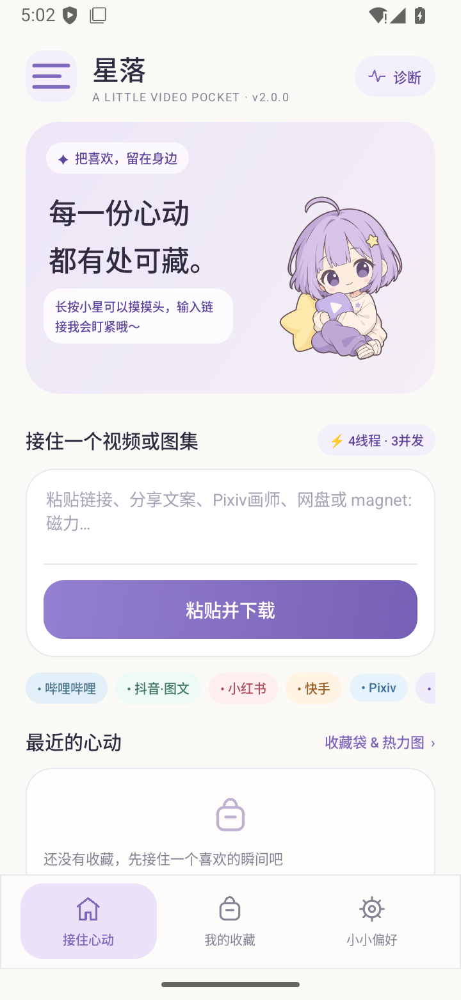
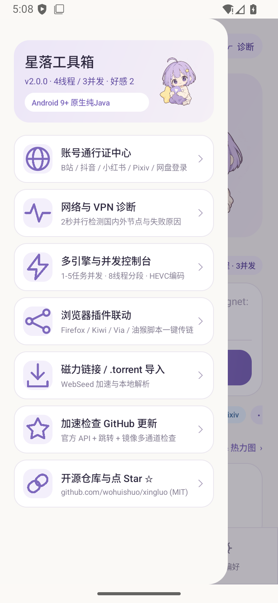
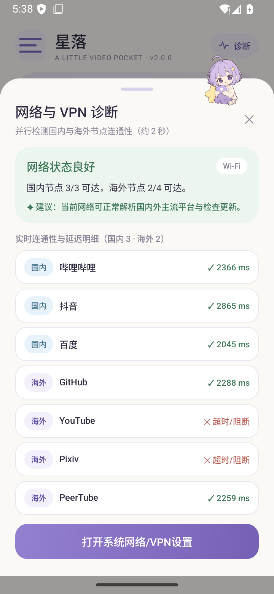
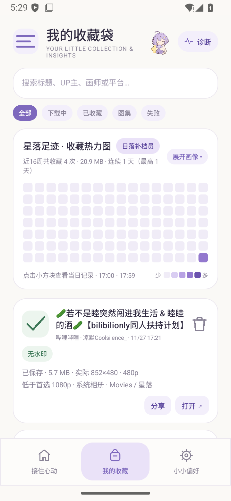
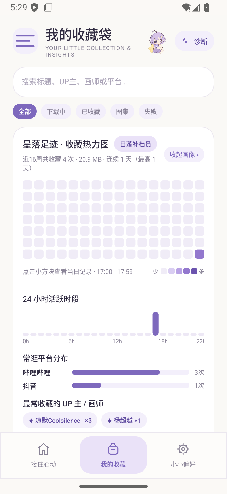
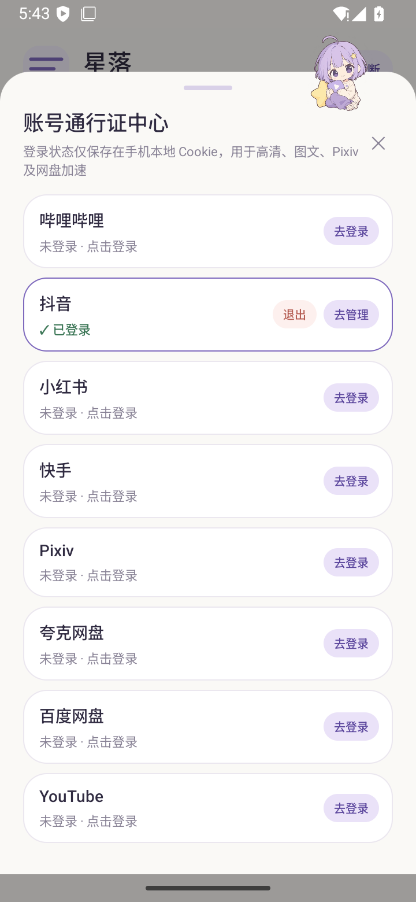
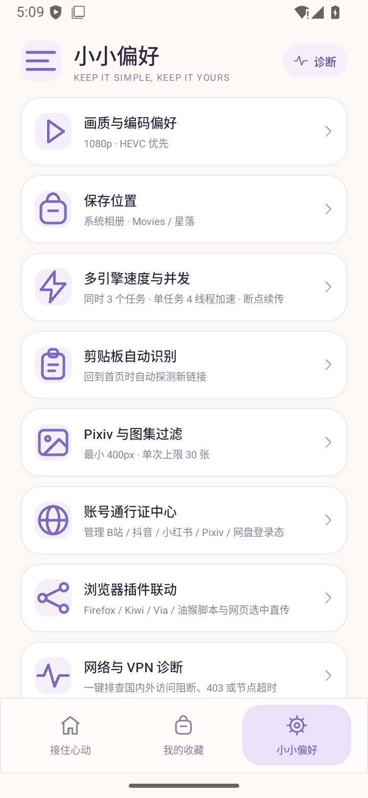

<div align="center">

<h1>✨ Xingluo (星落) v2.0.0</h1>

<p>
  <strong>Cute, lightweight, open-source Android 9+ native video &amp; gallery downloader</strong><br/>
  <sub>Pure Java + OkHttp · Only 4.45 MB (4.25 MiB) · Ad-free / Tracker-free / Local Cookie Sandbox · Living Mascot XiaoXing</sub>
</p>

<p>
  <a href="README.md">简体中文</a> ·
  <b>English</b> ·
  <a href="README.ja.md">日本語</a> ·
  <a href="README.zh-TW.md">繁體中文</a> ·
  <a href="README.es.md">Español</a>
</p>

<p>
  <a href="https://github.com/wohuishuo/xingluo/releases/latest"></a>
  
  
  
  
  <a href="LICENSE"></a>
</p>

</div>

---

> **v2.0.0 Milestone**: Evolving from the tiny v1.2.0 pocket tool into a full-featured **Android 9+ (`minSdk 28`, `targetSdk 35`) universal media downloader**—still under 4.5 MB with the exact same signing key for seamless upgrades over v1.x. Includes multi-thread Range segmentation, HLS/FLV live recording via Android `MediaMuxer`, Pixiv artist batch downloads with smart filtering, cloud drive & pure-Java BitTorrent support, mobile browser extension bridge, fixed in-app Cookie/OAuth login, Network/VPN Doctor, **Living XiaoXing** mascot interactions, and a **16-week Anki/GitHub-style activity heatmap**.

---

## 📸 Screenshots

<table>
  <tr>
    <td align="center" width="25%">
      <br/>
      <b>Home &amp; Living Mascot</b><br/><sub>Head-pat hearts · Input gaze · Smart paste</sub>
    </td>
    <td align="center" width="25%">
      <br/>
      <b>Toolkit Drawer</b><br/><sub>Accounts · Doctor · Engine · Bridge · BT</sub>
    </td>
    <td align="center" width="25%">
      <br/>
      <b>Network &amp; VPN Doctor</b><br/><sub>Parallel CN + Global latency &amp; block check</sub>
    </td>
    <td align="center" width="25%">
      <br/>
      <b>Bag &amp; 16-Week Heatmap</b><br/><sub>Search/filters · Item delete · File size/px</sub>
    </td>
  </tr>
  <tr>
    <td align="center" width="33%">
      <br/>
      <b>Taste Card Insights</b><br/><sub>24h chart · Platform mix · Top creators</sub>
    </td>
    <td align="center" width="33%">
      <br/>
      <b>Account Pass Center</b><br/><sub>Third-party Cookies &amp; OAuth popups fixed</sub>
    </td>
    <td align="center" width="33%">
      <br/>
      <b>Preferences &amp; Guides</b><br/><sub>Quality · Concurrency · Pixiv filter · Zero bloat</sub>
    </td>
  </tr>
</table>

---

## ✨ What's New in v2.0.0

### Speed, Protocols & Multi-Platform Coverage
- **1–5 Concurrent Tasks & 1–8 Thread Range Engine**: `SegmentedDownloader` powered by OkHttp 4.12 supports parallel byte-range chunks with `.part` resume checkpoints and real-time file size / resolution readout.
- **HLS + AES-128 + Live Stream Recording**: Handles `m3u8` master/media playlists, AES-128 decryption, pure-Java MPEG-TS/AAC muxing to standard MP4 via `MediaMuxer` (`TsToMp4Muxer`), and HTTP-FLV live recording with one-tap **"Stop & Save"**.
- **Pure-Java BitTorrent & WebSeed (BEP-0019)**: Parse `.torrent` / `magnet:` links and fetch pieces natively without bundling heavy C/C++ `.so` libraries.
- **CN, ACGN, Global & AI Platforms**:
  - **Bilibili**: WBI signing, `try_look=1`, HEVC/AVC, Live streams, creator & tag capture.
  - **Douyin & Kuaishou & Xiaohongshu**: Watermark-free video plus **Douyin Photo Albums (`图文`, `aweme_type=68`)** and lossless XHS image galleries.
  - **Pixiv**: Single multi-page artworks and **`/users/<uid>` artist batch downloads** organized into `Pixiv/<Artist>_<UID>/` with tag-enriched filenames and smart `ImageFilter` (skips avatars, banners, tiny icons, and optional AI-tagged works).
  - **Global & AI Share Pages**: YouTube, X/Twitter, TikTok, Reddit, Vimeo, Weibo, AcFun, PeerTube (MP4 + HLS), plus public Civitai, Runway, Luma, Jimeng, Kling, and Hailuo share links.
  - **Cloud Drives**: Quark, Baidu Netdisk (with share-code extraction), and Lanzou multi-thread acceleration.

### UX Fixes, Companion & Diagnostics (Addressing [Issue #1](https://github.com/wohuishuo/xingluo/issues/1))
- **Paste & Clipboard Fixes**: One-tap clear button `✕`, **"Paste New Link"** overwrite when input already contains text, and automatic clipboard link banner on returning home.
- **Individual Card Deletion & Search**: Delete any collection item (record-only or record + local file) alongside keyword search and category chips.
- **Fixed WebView Account Pass Center**: Supports third-party cookies and multi-window OAuth popups so Bilibili, Pixiv, Douyin, XHS, Quark, Baidu, and YouTube logins persist cleanly in your local device sandbox.
- **Network & VPN Doctor**: When PeerTube, YouTube, Pixiv, or any host times out, tap **"Diagnose"** for a fast parallel CN + Global connectivity test explaining whether VPN/proxy, login cookies, or segmented retries are needed.
- **Mobile Browser Companion**: Load the bundled MV3 extension (Firefox Android / Kiwi) or universal userscript `xingluo-bridge.user.js` (Via / X Browser / Lemur) from [browser-extension/](browser-extension/) to send links with one tap via `xingluo://download?url=...`.
- **Living XiaoXing & 16-Week Heatmap**: Blinking mascot that turns toward your input box with live link hints, emits hearts on long-press head-pats, tracks collection streaks across 16 weeks, and unfolds a personal Taste Card.

---

## 📊 Honest Verification & Comparison

| Dimension | Xingluo v2.0.0 | Seal / YTDLnis | NewPipe | Cobalt | gallery-dl |
| :--- | :--- | :--- | :--- | :--- | :--- |
| **APK Footprint** | **4.45 MB (Pure Java + OkHttp)** | ~50–90 MB (embedded Python/yt-dlp/FFmpeg) | ~10 MB | Web/API server | CLI via Termux |
| **Min Android** | **Android 9+ (API 28)** | Android 7+ | Android 5+ | Browser | Android Termux |
| **Pixiv Artist Batch & CN Photo Albums** | **Built-in native** | Limited outside yt-dlp video focus | N/A | N/A | Very strong CLI, no mobile UI |
| **VPN / Network Doctor** | **Built-in parallel probe** | Raw CLI logs | Basic error prompt | Server-side | CLI traceback |
| **Heavy DRM / Edge Muxing** | Lightweight native scope | **Strongest** (full `yt-dlp`+`ffmpeg`) | Strong on YouTube | High server availability | N/A |

### What Was Verified for v2.0.0
- **Live Android 16 Emulator (`emulator-5560`)**:
  - Clean upgrade over `v1.2.0` (matching cert SHA-256 `a1c38981a0945d9e0904b37d314797750d6237c450a19087ed4587bdf6c64d67`), `SmokeInstrumentation` (16/16 checks `OK`).
  - Live Douyin video downloaded & decoded cleanly with `ffmpeg`: `4,076,253` bytes (`h264 720×1280` + `aac`, `19.74s`).
  - Live Bilibili short-link video downloaded & decoded cleanly with `ffmpeg`: `5,930,435` bytes (`hevc 852×480` + `aac`, `62.08s`).
  - Network Doctor live probe verified under emulator Wi-Fi (`3/3` CN nodes OK `2045–2865 ms`, `2/4` Global nodes OK — accurately flagging YouTube/Pixiv timeout/block).
- **84 / 84 Unit Tests**: Full pass on all download engines, HLS AES-128, `TsToMp4Muxer`, `Bencode`/`TorrentMeta`/`TorrentDownloader`, extractors, `ImageFilter`, `NetworkDoctor`, `UpdateChecker`, and `ActivityStats` against real fixtures and a local `MiniHttpServer`.

---

## 🛠️ Build from Source

Requires **JDK 17+** and **Android SDK (`compileSdk 35`, `minSdk 28`)**:

```bash
./gradlew :app:testDebugUnitTest
./gradlew :app:lintDebug :app:assembleDebug
```

See [docs/release-2.0.0.md](docs/release-2.0.0.md) for full release notes and [docs/OPEN_SOURCE_REFERENCES.md](docs/OPEN_SOURCE_REFERENCES.md) for clean-room credits. MIT Licensed.
