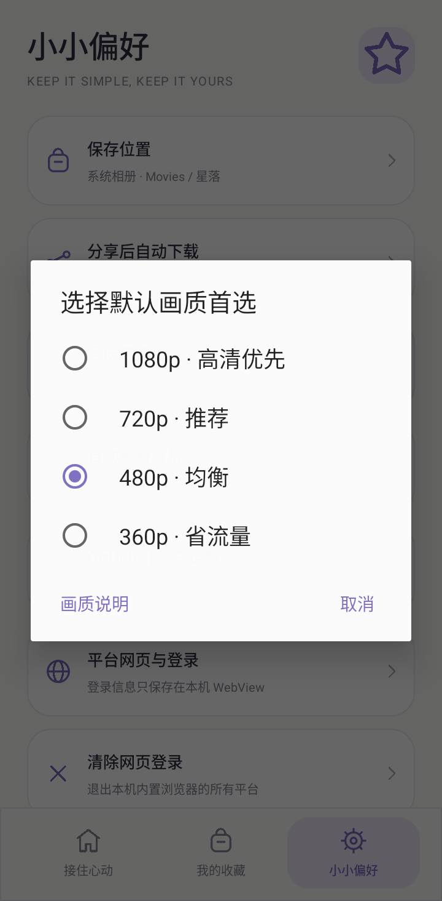

# Xingluo · Open-source Android Video Downloader

[简体中文](README.md) · [English](README.en.md)

**Xingluo (星落) is a lightweight, anime-themed Android video downloader for public Bilibili, Douyin and supported PeerTube links.** Paste a URL or share a link from another app, choose a destination and preferred quality, then see the actual saved resolution in your collection.

*Keep the videos you love in your pocket.*

[Download the latest APK](https://github.com/wohuishuo/xingluo/releases/latest) · [1.2.0 video demo](https://github.com/wohuishuo/xingluo/releases/download/v1.2.0/Xingluo-1.2.0-demo.mp4) · [Report an issue](https://github.com/wohuishuo/xingluo/issues) · [MIT License](LICENSE)

| Item | Details |
|---|---|
| App name | Xingluo / 星落 |
| Platform | Android 10 or newer, API 29+ |
| Release | [1.2.0](https://github.com/wohuishuo/xingluo/releases/tag/v1.2.0) |
| File formats | APK installer; saved videos are MP4 |
| License | MIT; source is available to inspect, modify and build |
| UI language | Simplified Chinese; the English README is a usage guide |

 

## Download and install

1. Open [Releases](https://github.com/wohuishuo/xingluo/releases/latest) and select the latest release.
2. Expand **Assets** and download **Xingluo-1.2.0.apk**. You can install it over the signed 1.1.0 release to keep your preferences and collection.
3. Open the APK on an Android 10+ device. If Android asks, allow installation from the app you used to download the file.

No GitHub account is required to download a public release. To support the project, sign in to GitHub and click **Star ☆** on the repository.

## Save a Bilibili, Douyin or PeerTube video

- Copy a share URL or the entire share message. Open Xingluo and tap **粘贴并下载** (paste and download).
- Alternatively, share a text link from another app to **星落**; saving starts automatically. Existing video files can also be shared to Xingluo.

The collection screen **我的收藏** shows progress and lets you cancel a task, play a saved video or share it again.

## Features

- **Destination choice:** system gallery under `Movies/星落`, Downloads under `Download/星落`, or a folder selected with Android's system picker.
- **Preferred quality and saved resolution:** choose 1080p, 720p, 480p or 360p. For multiple formats, the app chooses the largest available short edge up to the preference, or the closest available format above it. The collection shows the saved file dimensions and flags results below the preference.
- **Fresh-link retries:** network, parsing, media download or validation failures can resolve the original share link again. There are at most **three total attempts, including the first**. Cancellation stops retries.
- **Bilibili playback formats:** separate audio/video merging, backup CDN URLs and public MP4 fallback requests that carry the preferred quality.
- **Webpage fallback:** on-device WebView login and exposed-media detection, plus an optional PeanutDL webpage entry.

## Supported platforms and limitations

| Source | Current support |
|---|---|
| Bilibili (哔哩哔哩 / B站) | Public b23, BV, av and part links; available audio/video tracks can be merged |
| Douyin (抖音) | Public share pages, short links and exposed video data |
| PeerTube | Public watch, embed and short links for videos whose creator allows downloads and whose instance offers a complete MP4 |
| WeChat Channels (视频号) and other webpages | Actual MP4 URLs exposed on accessible webpages; video files already saved in WeChat can be shared to Xingluo |

Native WeChat cards, WeChat-only pages and encrypted content are not directly supported. HLS, DRM, livestreams, membership bypass and batch downloading all parts are not supported. Availability depends on platform changes, login status, region and network conditions. Douyin support does not imply TikTok support.

## Frequently asked questions

### How do I change the download folder?

Open **小小偏好 → 保存位置** (preferences → save location). Choose Gallery, Downloads or a custom folder. If a folder permission expires, select it again with the system picker. Changes apply to subsequent tasks.

### Can I always download 1080p or members-only videos?

No. Select a preference under **小小偏好 → 画质首选**. Source formats, login status and account permissions determine what is available. Xingluo does not bypass membership restrictions or upscale low-resolution files and label them HD.

### What happens after a parsing failure?

Xingluo can obtain a new media URL by resolving the original share link again. It makes up to three attempts in total, not three retries after the first attempt. Folder write or permission failures require selecting a valid destination.

### Can it download any WeChat Channels video?

No. Only actual MP4 media exposed by accessible webpages, or existing video files shared from WeChat, are supported. Native cards and encrypted video are outside the current scope.

### Is there an iPhone version?

No. The current installer is an APK for Android 10 and newer. There is no iOS build, and Android 9 or older cannot install this version.

## Privacy and permissions

Parsing and downloading run on the phone, without a project-operated parsing server. WebView cookies stay on the device and are requested for the destination domain. If you choose the optional PeanutDL webpage fallback, that service receives the shared link.

No contacts, photo-library read or all-files permission is required. Custom folders use the directory permission granted through Android's picker. Notification permission is used for background progress.

Only save content you have permission to use, and respect its creators.

## Build from source

Requirements: JDK 21, Android SDK 35, Gradle wrapper 9.6.0 and Android Gradle Plugin 9.4.0. Set `sdk.dir` in your local `local.properties` file.

```bash
./gradlew :app:testDebugUnitTest :app:lintDebug :app:assembleDebug
```

Use `gradlew.bat` on Windows. If non-ASCII paths cause a build issue, pass `-PxingluoBuildDir=C:/xingluo-build` to move the build output without moving the source.

Release signing is configured locally in `release-signing.properties`; see the [Chinese build instructions](README.md#构建与测试) for its fields. Official signing keys are not in the repository. A build signed with a different key cannot update the official APK in place.

See the [1.2.0 release notes](https://github.com/wohuishuo/xingluo/releases/tag/v1.2.0) for sample file measurements and Android 16 emulator results.

## Credits and license

The implementation refers to Android media/storage documentation and public platform-protocol descriptions from yt-dlp; yt-dlp itself is not embedded. The Xiaoxing mascot was generated for this project with AI. Repository source and assets are under the [MIT License](LICENSE).

Xingluo is an independent project, not an official Bilibili, Douyin or WeChat application. Platform names and trademarks belong to their respective owners.
