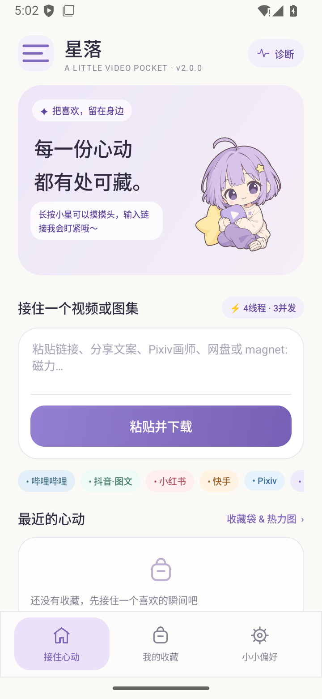
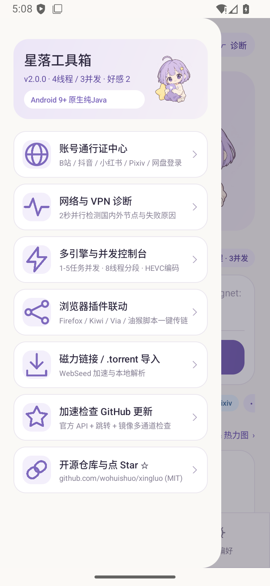
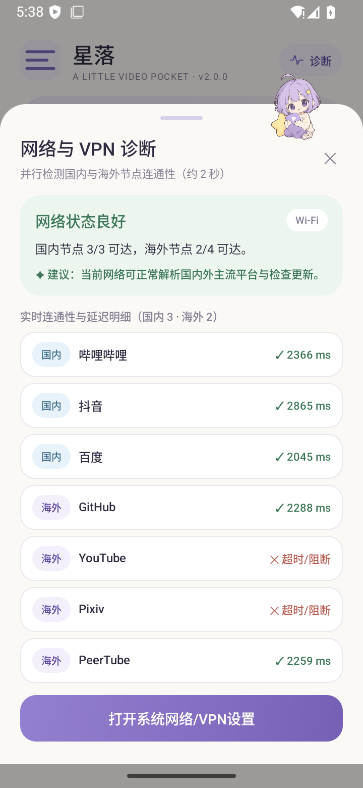
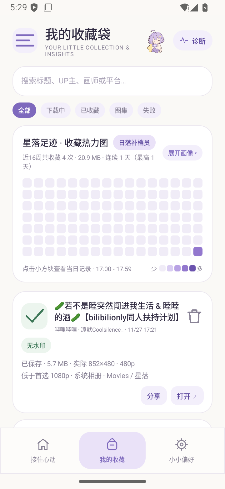

<div align="center">

<h1>✨ Xingluo (星落) v2.0.0</h1>

<p>
  <strong>Descargador nativo de código abierto para Android 9+: videos, galerías, directos y nubes en solo 4.45 MB</strong><br/>
  <sub>Java puro + OkHttp · Sin anuncios ni rastreadores · Cookies locales aisladas · Mascota interactiva XiaoXing</sub>
</p>

<p>
  <a href="README.md">简体中文</a> ·
  <a href="README.en.md">English</a> ·
  <a href="README.ja.md">日本語</a> ·
  <a href="README.zh-TW.md">繁體中文</a> ·
  <b>Español</b>
</p>

<p>
  <a href="https://github.com/wohuishuo/xingluo/releases/latest"></a>
  
  
  
  <a href="LICENSE"></a>
</p>

</div>

---

> **Novedad v2.0.0**: Compatible con **Android 9+ (`minSdk 28`)** manteniendo un APK ligero de **4.45 MB (4.25 MiB)** y la misma clave de firma que v1.2.0 para actualizar sin perder datos. Incorpora descargas multihilo (1–8 hilos con reanudación `.part`), cola de 1–5 tareas simultáneas, grabación de directos HLS/FLV a MP4 con `MediaMuxer`, descargas por lotes de artistas de Pixiv con filtrado inteligente, enlaces `magnet:`/`.torrent` en Java puro, puente con navegadores móviles ([browser-extension/](browser-extension/)), inicio de sesión WebView reparado y diagnóstico de red/VPN en paralelo.

---

## 📸 Capturas

<table>
  <tr>
    <td align="center" width="25%"><br/><b>Inicio y XiaoXing</b></td>
    <td align="center" width="25%"><br/><b>Menú de herramientas</b></td>
    <td align="center" width="25%"><br/><b>Doctor de Red y VPN</b></td>
    <td align="center" width="25%"><br/><b>Colección y mapa 16 sem.</b></td>
  </tr>
</table>

---

## ✨ Aspectos destacados

- **Plataformas**: Bilibili (firma WBI, `try_look=1`, HEVC/AVC, Directos), Douyin (videos sin marca + **álbumes de fotos `图文`**), Kuaishou, Xiaohongshu (videos y galerías sin pérdida), Pixiv (obras individuales y lotes de artista `/users/<uid>` con etiquetas y filtro de imágenes), YouTube, X/Twitter, TikTok, Reddit, Vimeo, PeerTube, enlaces públicos de IA (Civitai, Runway, Luma, Jimeng, Kling, Hailuo) y nubes (Quark, Baidu Netdisk, Lanzou).
- **Diagnóstico de Red/VPN**: Al fallar una descarga o pulsar «Diagnóstico», analiza en 2–4 segundos nodos locales y globales para indicar si falta VPN, sesión o reintento.
- **Extensión móvil**: Incluye complemento MV3 (Firefox Android / Kiwi) y userscript `xingluo-bridge.user.js` (Via / Tampermonkey).
- **Verificación honesta**: Probado en emulador Android 16 (actualización sobre v1.2.0, 16 pruebas UI `SmokeInstrumentation`, descargas reales verificadas con `ffmpeg` en Douyin `720×1280` y Bilibili `852×480`) junto con `84 / 84` pruebas unitarias superadas.

## 🛠️ Compilación

```bash
./gradlew :app:testDebugUnitTest
./gradlew :app:lintDebug :app:assembleDebug
```

Consulta [docs/release-2.0.0.md](docs/release-2.0.0.md) para ver el registro de cambios completo. Licencia MIT.
