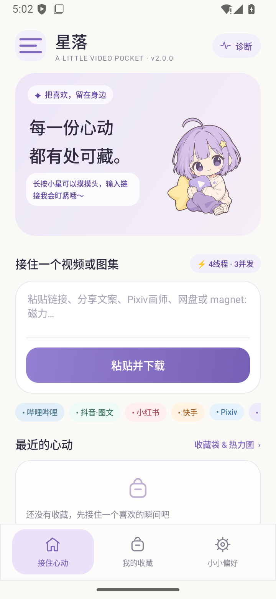
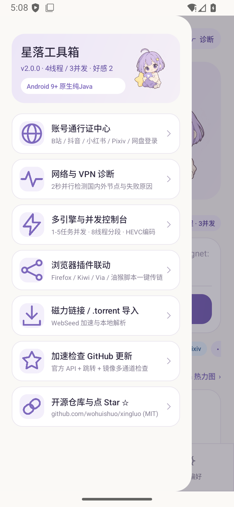
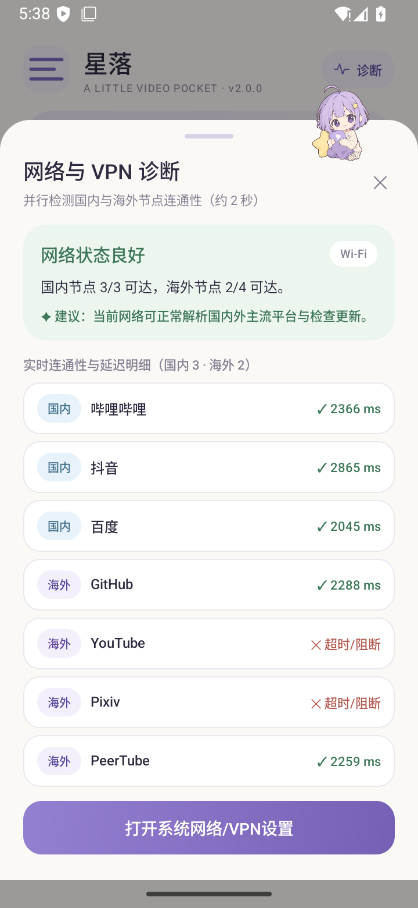
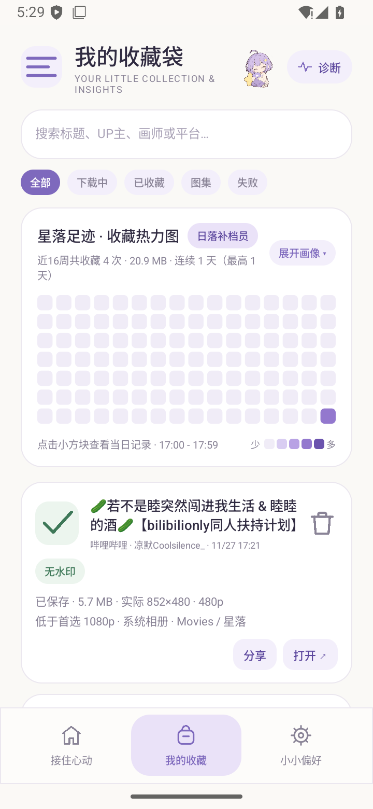

<div align="center">

<h1>✨ 星落 Xingluo v2.0.0</h1>

<p>
  <strong>かわいくて軽量・オープンソースの Android 9+ ネイティブ動画＆イラストダウンローダー</strong><br/>
  <sub>Pure Java + OkHttp · わずか 4.45 MB（4.25 MiB）· 広告なし / 追跡なし / ローカル Cookie 分離 · 生きたマスコット「小星」</sub>
</p>

<p>
  <a href="README.md">简体中文</a> ·
  <a href="README.en.md">English</a> ·
  <b>日本語</b> ·
  <a href="README.zh-TW.md">繁體中文</a> ·
  <a href="README.es.md">Español</a>
</p>

<p>
  <a href="https://github.com/wohuishuo/xingluo/releases/latest"></a>
  
  
  
  <a href="LICENSE"></a>
</p>

</div>

---

> **v2.0.0 の進化**：4.45 MB の超軽量さと v1.2.0 同一署名キー（上書きアップデート対応）を維持したまま、**Android 9 以上（API 28+）** 向けにエンジン・対応サイト・UI アニメーションを全面刷新しました。Pixiv 絵師一括保存＆タグ付きフォルダ整理、Bilibili / Douyin / 小紅書 / 快手 / PeerTube / AI 動画、HLS ライブ録画（MediaMuxer MP4 変換）、純 Java BitTorrent/WebSeed、モバイルブラウザ拡張連携、ネットワーク・VPN 診断、そして「小星」とのインタラクティブ体験＆16 週間ヒートマップを搭載しています。

---

## 📸 スクリーンショット

<table>
  <tr>
    <td align="center" width="25%"><br/><b>ホーム＆活体小星</b></td>
    <td align="center" width="25%"><br/><b>ツールボックス</b></td>
    <td align="center" width="25%"><br/><b>ネットワーク / VPN 診断</b></td>
    <td align="center" width="25%"><br/><b>コレクション＆16週マップ</b></td>
  </tr>
</table>

---

## ✨ 主な機能とアップデート内容

- **高速・並列マルチスレッドエンジン**：最大 1〜5 タスク同時実行、1 タスクあたり 1〜8 スレッド Range 分割ダウンロード＆ `.part` レジュームに対応。カード上に実容量と実解像度を表示。
- **Pixiv 絵師一括保存＆スマートフィルタ**：単体複数枚作品に加え、`/users/<uid>` 作家ページから `Pixiv/<絵師名>_<UID>/` へタグ付きファイル名で自動保存。アイコン・背景バナー・低解像度画像・AI タグ作品（オンオフ可）を自動除外。
- **ライブ配信録画 & HLS/AES-128**：`m3u8` / HTTP-FLV に対応し、Android 標準 `MediaMuxer` による純 Java MP4 出力と「停止して保存」が可能。
- **クラウドストレージ & 純 Java BitTorrent**：Quark / Baidu Netdisk（パスコード認識）/ Lanzou、および `.torrent`・`magnet:`・BEP-0019 WebSeed に対応。
- **モバイルブラウザ連携 ([browser-extension/](browser-extension/))**：Firefox Android / Kiwi 用 MV3 拡張機能および Via / Xブラウザ / Tampermonkey 用ユーザースクリプト `xingluo-bridge.user.js` を同梱。
- **内蔵アカウントパス修正 & ネットワーク/VPN 診断**：サードパーティ Cookie と OAuth ポップアップログインに対応し、すべて端末ローカルの `WebView` サンドボックスにのみ保存。失敗時は 2〜4 秒で国内外ノードを並列チェックし、VPN 切り替えやログイン要否を案内します。
- **「活体小星」コンパニオン & 統計**：瞬き・入力欄への視線追従・長押し撫で撫でハート・トリプルタップ隠しプロフィール・16 週間 Anki/GitHub 風ヒートマップを実装。

## 🔍 検証状況（透明性レポート）
- **実機相当 Android 16 エミュレータ (`emulator-5560`)**：v1.2.0 からの上書き更新、16 項目の `SmokeInstrumentation`、Douyin 実ダウンロード（`720×1280 H.264+AAC`）、Bilibili 実ダウンロード（`852×480 HEVC+AAC`）を `ffmpeg` デコードエラー 0 で検証済み。
- **ユニットテスト**：`84 / 84` 全件パス（全エンジン・パーサ・フィルタ・診断・統計ロジックをローカル `MiniHttpServer` 等で検証済み）。

## 🛠️ ビルド手順

```bash
./gradlew :app:testDebugUnitTest
./gradlew :app:lintDebug :app:assembleDebug
```

詳細リリースノートは [docs/release-2.0.0.md](docs/release-2.0.0.md) をご覧ください。MIT License.
