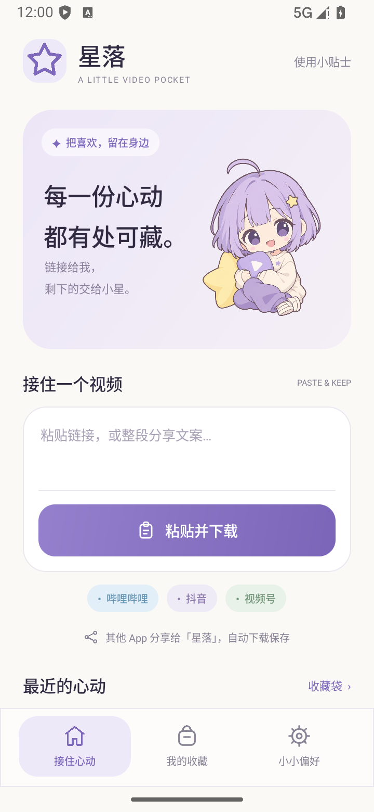
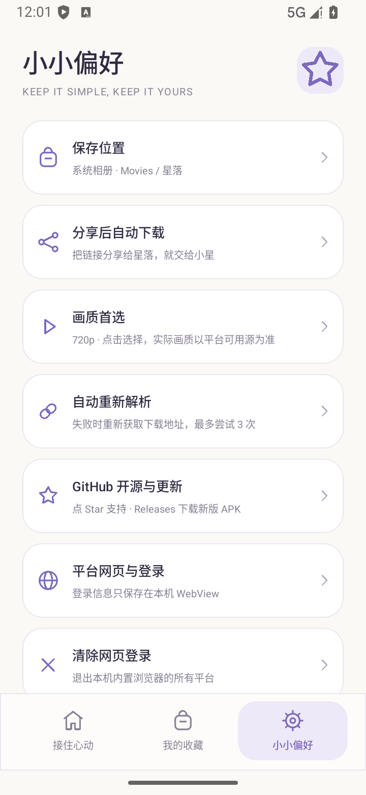

# ✦ 星落 Xingluo

**把喜欢的视频，放进口袋。** 一个轻量、可爱的开源安卓视频保存应用。

[下载安装包](https://github.com/wohuishuo/xingluo/releases/latest) · [反馈问题](https://github.com/wohuishuo/xingluo/issues) · [MIT License](LICENSE)

 

## 怎么下载和安装

1. 打开右侧 **Releases**，或直接点击上方“下载安装包”。
2. 进入标有 **Latest** 的最新版本。
3. 在 **Assets** 中点击 `Xingluo-1.1.0.apk`。下载应用请选 `.apk`，不要选 Source code。
4. 在 Android 10 或更高版本的手机上打开 APK 安装；系统询问时允许当前下载来源安装应用。

喜欢的话，登录 GitHub 后点击仓库右上角 **Star ☆**，谢谢你支持小星！

## 只要两种操作

- 复制链接或整段分享文案，打开星落，点 **粘贴并下载**。
- 在其他 App 把文字链接或视频文件分享到 **星落**，自动开始保存。

收藏袋可查看进度、取消、播放已保存的视频，并再次分享。

## 1.1 新增

- **真正可选的保存位置**：系统相册 `Movies/星落`、下载目录 `Download/星落`，或用系统选择器授权自己的文件夹。
- **画质首选**：1080p / 720p / 480p / 360p。B站会请求所选档位并选择合适轨道；抖音有多档源时选择相应来源。实际画质取决于平台提供的公开格式，不会把低清伪装成高清。
- **最多 3 次重新解析**：网络、解析、媒体下载或校验失败时，重新解析原分享链接，获取新地址。取消会终止后续尝试。
- B站支持平台返回的备用 CDN、音画自动合并，以及公开合并 MP4 回退。
- 本机 WebView 正常登录与网页媒体识别，另有 PeanutDL 备用网页入口。

## 支持范围

| 来源 | 当前能力 |
|---|---|
| 哔哩哔哩 | b23/BV/av/分P链接、公开可用视频；分离音画合并；受限时回退公开 MP4 |
| 抖音 | 短链接、公开分享页面、页面中的视频数据 |
| 视频号 / 其他网页 | 识别可访问网页中暴露的实际 MP4；可接收微信先保存后分享的视频文件 |

视频号原生卡片可能没有网页链接，微信内限定内容或加密视频不能保证保存。暂不支持 HLS、DRM、直播、会员限制绕过和批量全分P下载。平台规则、登录状态、地区和网络会影响结果。错误会显示原因，三次失败后可手动用网页识别或稍后重试。

## 隐私与权限

解析和下载在手机完成，没有自建解析服务器。Cookie 保存在本机 WebView，每次请求按目标域名获取，不跨域转发。启用备用网页解析时，链接交由 PeanutDL 处理。无需通讯录、相册读取或全部文件权限；自选文件夹仅使用系统授予的目录权限。通知权限用于后台进度。

请只保存你有权使用的内容，尊重创作者。

## 构建与测试

JDK 21、Android SDK 35、Gradle wrapper 9.6.0、AGP 9.4.0。配置本机 `local.properties` 的 `sdk.dir`。

```bash
./gradlew :app:testDebugUnitTest :app:lintDebug :app:assembleDebug
```

Windows 用 `gradlew.bat`。若用户名或路径包含非 ASCII 字符，可以传入 `-PxingluoBuildDir=C:/xingluo-build` 指定构建输出，源文件无需移动。

本地签名配置 `release-signing.properties`：

```properties
storeFile=keystore/release.jks
storePassword=YOUR_LOCAL_PASSWORD
keyAlias=xingluo
keyPassword=YOUR_LOCAL_PASSWORD
```

自行生成并保管密钥后运行 `:app:assembleRelease`。仓库不包含官方签名私钥。使用不同签名构建的 APK 不能直接覆盖官方安装包。

当前有 21 项纯逻辑测试和 12 项 Android 仪器检查，覆盖链接、画质选择、重试边界、音画合并、保存、取消回滚、持久化、分享入口和界面重建。已在 Android 16 模拟器实测；旧版 Android 通过 minSdk/API 检查，未宣称全部真机验证。

## 致谢与许可

参考 Android 官方媒体/存储文档和 yt-dlp 的公开平台协议说明；代码为独立实现，未内嵌 yt-dlp。小星角色为本项目 AI 生成原创素材。源码与仓库内素材采用 MIT License。第三方平台名称与标识归各自所有。
