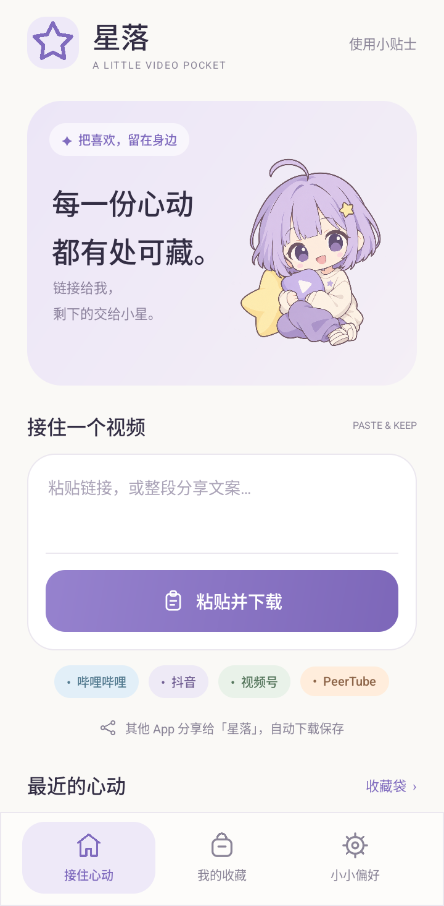
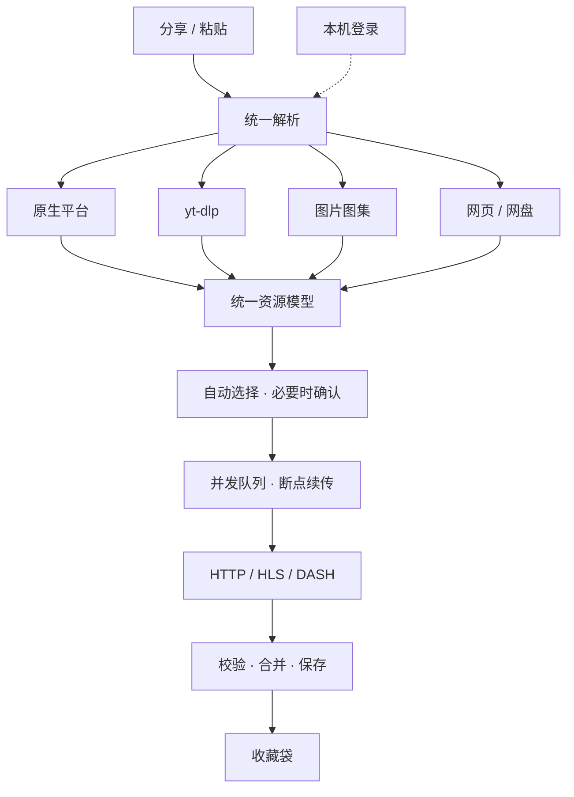

# 星落 Xingluo · 开源安卓视频下载器

[简体中文](README.md) · [English](README.en.md)

**星落（Xingluo）是一款二次元风格的开源 Android 视频下载器，支持 B站（哔哩哔哩 / bilibili）、抖音（Douyin）和符合条件的 PeerTube 公开链接。** 可选择保存目录、默认画质，收藏袋会显示实际保存分辨率。视频号仅支持可访问网页中提供的实际视频文件。

*把喜欢的视频，放进口袋。*

[下载最新版 APK](https://github.com/wohuishuo/xingluo/releases/latest) · [1.2.0 画质演示](https://github.com/wohuishuo/xingluo/releases/download/v1.2.0/Xingluo-1.2.0-demo.mp4) · [常见问题](#常见问题) · [反馈问题](https://github.com/wohuishuo/xingluo/issues) · [MIT License](LICENSE)

| 项目 | 信息 |
|---|---|
| 应用名称 | 星落 / Xingluo |
| 设备要求 | Android 10 及以上（API 29+）；安卓手机应用 |
| 正式版本 | [1.2.0](https://github.com/wohuishuo/xingluo/releases/tag/v1.2.0) |
| 文件格式 | APK 安装包；下载的视频保存为 MP4 |
| 许可 | MIT，源码可查看、修改和自行构建 |

 

## 下载与安装 APK

1. 打开右侧 **Releases**，或直接点击上方“下载最新版 APK”。
2. 进入标有 **Latest** 的最新版本。
3. 在 **Assets** 中点击 `Xingluo-1.2.0.apk`。已有 GitHub 正式版 1.1.0 可直接覆盖安装，保留收藏和偏好。**Source code** 是源码压缩包。
4. 在 Android 10 或更高版本的手机上打开 APK 安装；系统询问时允许当前下载来源安装应用。

喜欢的话，登录 GitHub 后点击仓库右上角 **Star ☆**，谢谢你支持小星！

## 如何下载 B站、抖音和 PeerTube 视频

- 复制链接或整段分享文案，打开星落，点 **粘贴并下载**。
- 在其他 App 把文字链接或视频文件分享到 **星落**，自动开始保存。

收藏袋可查看进度、取消、播放已保存的视频，并再次分享。

## 主要功能

- **真正可选的保存位置**：系统相册 `Movies/星落`、下载目录 `Download/星落`，或用系统选择器授权自己的文件夹。
- **画质首选和实测分辨率**：可选 1080p / 720p / 480p / 360p。多档选源时优先取不超过首选的最高清晰度，横竖屏按短边比较。收藏袋显示文件实际宽高，低于首选时会提示。
- **最多 3 次重新解析**：网络、解析、媒体下载或校验失败时，重新解析原分享链接，获取新地址。取消会终止后续尝试。
- B站支持平台返回的备用 CDN、音画自动合并和公开合并 MP4 回退，回退请求也会保留所选档位。
- 本机 WebView 正常登录与网页媒体识别，另有 PeanutDL 备用网页入口。

## 支持的平台与链接范围

| 来源 | 当前能力 |
|---|---|
| 哔哩哔哩 | b23/BV/av/分P链接、公开可用视频；分离音画合并；受限时回退公开 MP4 |
| 抖音 | 短链接、公开分享页面、页面中的视频数据 |
| PeerTube | 公开的 `/w/…`、`/videos/watch/…` 和 `/videos/embed/…` 视频链接。作者须开放下载，且站点须提供完整的 MP4 |
| 视频号 / 其他网页 | 识别可访问网页中暴露的实际 MP4；可接收微信先保存后分享的视频文件 |

视频号原生卡片可能没有网页链接，微信内限定内容或加密视频不能保证保存。暂不支持 HLS、DRM、直播、会员限制绕过和批量全分P下载。平台规则、登录状态、地区和网络会影响结果。错误会显示原因，三次失败后可手动用网页识别或稍后重试。

## 开发路线图 · 万能下载器

> 以下为规划中的架构及功能，不代表 v1.2.0 已支持。现有 APK 的支持范围以上方表格为准。

星落仍然只有一个入口：分享或粘贴，自动选择作品资源并保存。



| 资源类型 | 规划目标 |
|---|---|
| 🎬 视频 | B站、抖音、PeerTube；扩展快手、YouTube 等 |
| 🖼️ 图片 / 图集 | Pixiv、小红书、抖音图文；只保存作品本身 |
| 📁 普通文件 | HTTP 文件、分享导入、断点续传 |
| ☁️ 网盘 | 百度、夸克、WebDAV；按授权与实测结果开放 |
| 🌐 网页 | 可访问的媒体、非 DRM HLS/DASH |
| 🎧 扩展 | 音频、字幕；直播与 BT 后续评估 |

[完整架构设计、上游源码复用清单与测试计划](docs/universal-downloader-architecture.md)

## 常见问题

### 下载星落需要 GitHub 账号吗？

下载公开的 APK 安装包不需要登录 GitHub。打开 [最新版 Releases](https://github.com/wohuishuo/xingluo/releases/latest)，展开 **Assets**，选择 `.apk` 文件即可。**Source code** 是源码压缩包，不能作为安卓应用直接安装。给项目点 Star 需要登录 GitHub。

### 星落支持 iPhone 或旧安卓手机吗？

目前提供 Android 10 及以上版本的 APK，不提供 iOS 安装包。Android 9 或更低版本不能安装当前版本。

### 如何选择视频保存目录？

打开底部 **小小偏好 → 保存位置**，选择系统相册 `Movies/星落`、下载目录 `Download/星落`，或使用系统选择器授权自选文件夹。目录授权失效时，在这里重新选择文件夹；更改对后续任务生效。

### 可以下载 1080p 视频或会员视频吗？

可在 **小小偏好 → 画质首选** 选择 1080p、720p、480p 或 360p，保存后在收藏袋查看实际分辨率。实际清晰度取决于平台公开提供的格式、登录状态与账号权限。只有高于首选的档位时，多档选择会用最接近的可用档位。平台只返回单一格式时使用该格式。

### 第一次解析失败后会自动重试吗？

会。网络、解析、媒体下载或校验失败时，星落会重新解析**原分享链接**，尝试获取新的下载地址。每个任务**总共最多尝试 3 次，包含首次尝试**；取消会停止后续尝试。目录写入或授权问题需要重新选择保存位置。

### 能直接下载微信视频号卡片吗？

不能保证。星落可识别可访问网页中暴露的实际 MP4，也可接收微信先保存后分享的视频文件；暂不支持直接解析微信原生卡片、微信内限定内容或加密视频。它不是全平台万能解析器。

## 隐私与权限

解析和下载在手机完成，没有自建解析服务器。Cookie 保存在本机 WebView，每次请求按目标域名获取，不跨域转发。启用备用网页解析时，链接交由 PeanutDL 处理。无需通讯录、相册读取或全部文件权限；自选文件夹仅使用系统授予的目录权限。通知权限用于后台进度。

请只保存你有权使用的内容，尊重创作者。

## 构建与测试

JDK 21、Android SDK 35、Gradle wrapper 9.6.0、AGP 9.4.0。配置本机 `local.properties` 的 `sdk.dir`。

```bash
./gradlew :app:testDebugUnitTest :app:lintDebug :app:assembleDebug
```

Windows 用 `gradlew.bat`。若用户名或路径包含非 ASCII 字符，可以传入 `-PxingluoBuildDir=C:/xingluo-build` 指定构建输出，源文件无需移动。

本地签名配置 `release-signing.properties`：

```properties
storeFile=keystore/release.jks
storePassword=YOUR_LOCAL_PASSWORD
keyAlias=xingluo
keyPassword=YOUR_LOCAL_PASSWORD
```

自行生成并保管密钥后运行 `:app:assembleRelease`。仓库不包含官方签名私钥。使用不同签名构建的 APK 不能直接覆盖官方安装包。

公开链接与实际文件的抽样数据见 [1.2.0 发布说明](https://github.com/wohuishuo/xingluo/releases/tag/v1.2.0)。应用在 Android 16 模拟器验证，安卓最低版本以 API 29 为准。

## 致谢与许可

参考 Android 官方媒体/存储文档和 yt-dlp 的公开平台协议说明；代码为独立实现，未内嵌 yt-dlp。小星角色为本项目 AI 生成原创素材。源码与仓库内素材采用 MIT License。星落是独立开源项目，非哔哩哔哩、抖音或微信官方应用；第三方平台名称与标识归各自所有。
