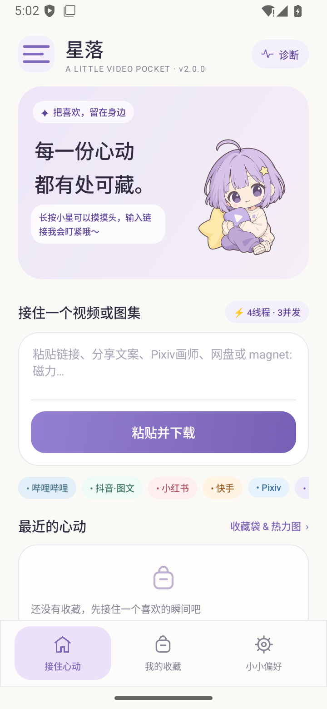
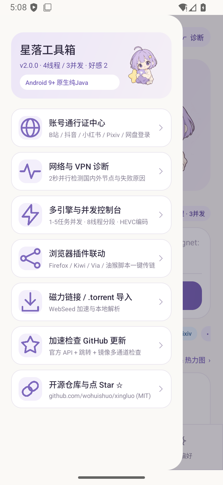
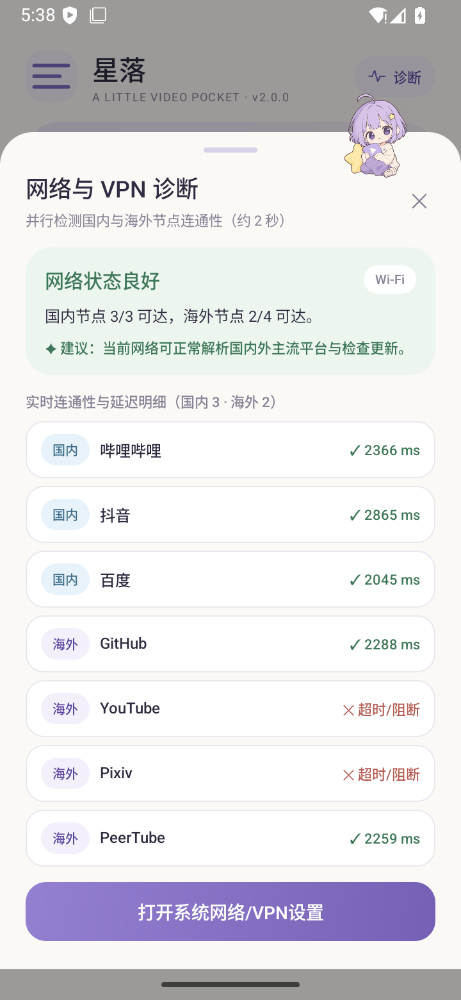
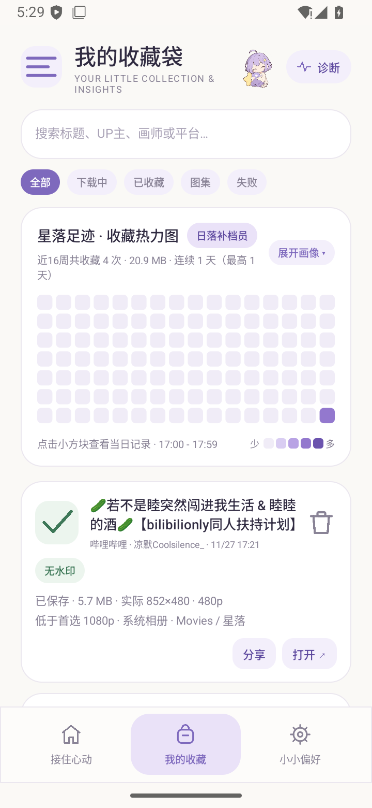
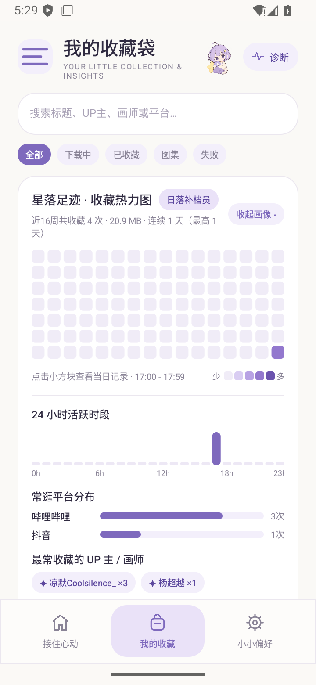
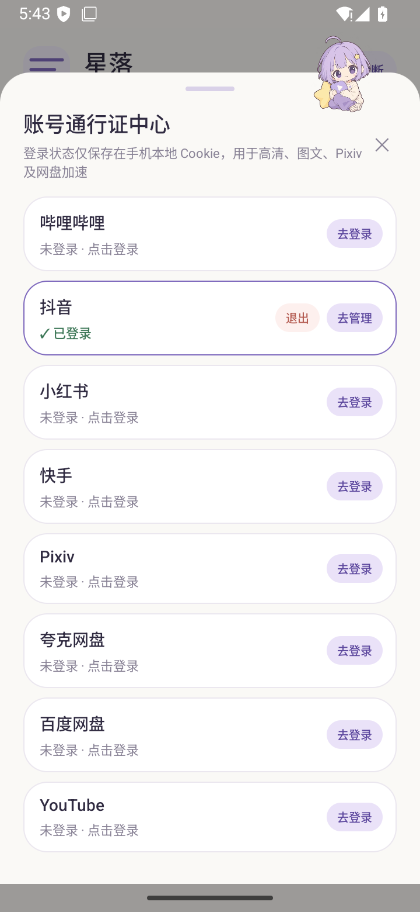
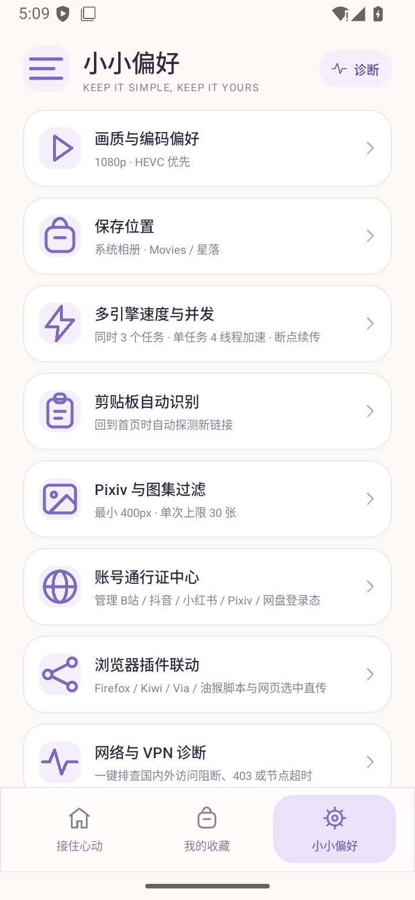
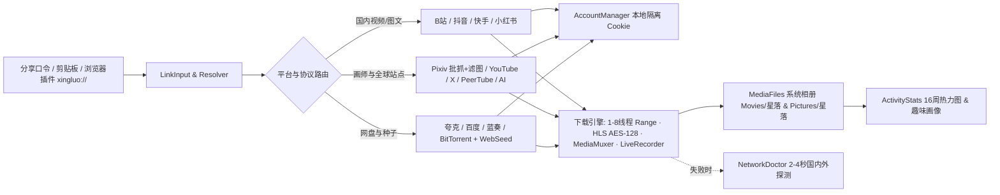

<div align="center">

<h1>✨ 星落 Xingluo v2.0.0</h1>

<p>
  <strong>可爱、轻量、开源的 Android 9+ 原生视频与图文全能下载器</strong><br/>
  <sub>原生纯 Java + OkHttp · 仅 4.45 MB（4.25 MiB）· 无广告 / 无追踪 / 本地 Cookie 隔离 · 有温度的小星伙伴</sub>
</p>

<p>
  <b>简体中文</b> ·
  <a href="README.en.md">English</a> ·
  <a href="README.ja.md">日本語</a> ·
  <a href="README.zh-TW.md">繁體中文</a> ·
  <a href="README.es.md">Español</a>
</p>

<p>
  <a href="https://github.com/wohuishuo/xingluo/releases/latest"></a>
  
  
  
  
  <a href="LICENSE"></a>
</p>

</div>

---

> **v2.0.0 里程碑**：从 v1.2.0 轻量化工具全面进化为 **Android 9+（`minSdk 28`, `targetSdk 35`）全能下载器**。保留了不到 4.5 MB 的轻量体积与同一把签名密钥（支持从 v1.x 直接覆盖升级），重构多线程引擎、直播录制、Pixiv 画师批抓与过滤、网盘解析、纯 Java 磁力/种子、手机浏览器插件联动、内置网页登录修复、网络/VPN 诊断，以及会眨眼会互动的 **「活体小星」** 与 **16 周收藏热力图**。

---

## 📸 界面与交互展示

<table>
  <tr>
    <td align="center" width="25%">
      <br/>
      <b>首页与活体小星</b><br/><sub>长按摸头 · 盯链提示 · 一键清粘贴</sub>
    </td>
    <td align="center" width="25%">
      <br/>
      <b>星落工具箱抽屉</b><br/><sub>通行证 · 诊断 · 并发 · 插件 · 磁力</sub>
    </td>
    <td align="center" width="25%">
      <br/>
      <b>网络与 VPN 诊断</b><br/><sub>国内外并行探测 · 识别阻断与代理</sub>
    </td>
    <td align="center" width="25%">
      <br/>
      <b>收藏袋与 16 周热力图</b><br/><sub>搜索/筛选 · 单条删除 · 体积分辨率</sub>
    </td>
  </tr>
  <tr>
    <td align="center" width="33%">
      <br/>
      <b>趣味偏好画像</b><br/><sub>24h 时段分布 · 常逛平台 · 高频 UP 主</sub>
    </td>
    <td align="center" width="33%">
      <br/>
      <b>账号通行证中心</b><br/><sub>修复三方 Cookie 与 OAuth 弹窗登录</sub>
    </td>
    <td align="center" width="33%">
      <br/>
      <b>小小偏好与国产安装指南</b><br/><sub>画质/并发/图集过滤 · 零多余权限</sub>
    </td>
  </tr>
</table>

---

## ✨ v2.0.0 核心新特性（重点修复与扩展）

### 1. 针对 [Issue #1](https://github.com/wohuishuo/xingluo/issues/1) 社区反馈的逐项修复
- **输入框有内容也能顺手粘贴**：新增输入栏右侧一键清空 `✕` 与 **「粘贴新链接」** 覆盖粘贴，并在「小小偏好」支持回到首页自动探测剪贴板新链接。
- **收藏袋支持单条删除与搜索**：每张任务卡片新增独立删除按钮，可选 **「仅移除记录」** 或 **「连同本地文件一起删除」**，并支持关键词搜索与状态筛选（全部 / 下载中 / 已收藏 / 图集 / 失败）。
- **卡片直观显示大小与真实分辨率**：每条收藏展示精准文件体积与 `ffprobe` 级真实像素分辨率（如 `5.7 MB · 实际 852×480`、`3.9 MB · 实际 720×1280`）。
- **抖音图文（Photo Album）正式支持**：完整解析 `aweme_type=68` / `images[]` 图文作品并按原图序集保存。
- **快手 / 小红书 / 常见 AI 视频页**：新增快手无水印解析、小红书无水印视频与无损图集，以及 Civitai / Runway / Luma / 即梦 / 可灵 / 海螺 等公开分享页媒体提取。
- **可调节并发队列与多线程提速**：支持同时运行 **1–5 个下载任务**，单任务支持 **1–8 线程 HTTP Range 分段并发**与 `.part` 断点续传，拒绝大文件/弱网下“龟速”与整包重下。
- **下载失败解释与网络/VPN 诊断**：遇到海外节点或 PeerTube/YouTube/Pixiv 超时或 403，卡片直接提供 **「诊断原因」**，2–4 秒并行测试国内与海外连通性，明确提示是否需要开启 VPN、更新 Cookie 或重试分段。

### 2. 高阶平台、Pixiv 画师批抓与极客工具箱
- **Pixiv 专精模式**：不仅支持单作品多 P 原图（自动带 `Referer: https://www.pixiv.net/`），更支持 **`/users/<uid>` 画师主页批量抓取**，按 `Pixiv/<作者名>_<UID>/` 自动建目录，文件名携带 Tag 标签；内置 `ImageFilter` 自动过滤头像、背景横幅、小图标及可开关的 AI 生成标记作品。
- **HLS / 直播流录制与 MP4 无损封装**：支持 `m3u8` 分片、AES-128 解密、纯 Java `TsToMp4Muxer`（基于 Android 原生 `MediaMuxer` 合成标准 MP4）与 HTTP-FLV 直播录制，随时点 **「停止并保存」** 将已录部分完整导出至相册。
- **纯 Java BitTorrent / `.torrent` / Magnet（含 BEP-0019 WebSeed）**：无需额外 C/C++ SO 库，原生解析 Bencode、Torrent 元数据、Peer wire 协议与 HTTPS WebSeed 混下。
- **网盘加速解析**：支持夸克网盘、百度网盘（含分享页提取码自动识别）、蓝奏云多线程加速与断点续传。
- **手机浏览器插件联动**：仓库随附 [browser-extension](browser-extension/)（Firefox / Kiwi Android MV3 扩展）与通用油猴脚本 `xingluo-bridge.user.js`（适配 Via / X浏览器 / Lemur / Tampermonkey），浏览任意网页点选小星悬浮球或选中文本即可通过 `xingluo://download?url=...` 唤起下载。
- **加速检查 GitHub 更新**：支持 GitHub Official API + Latest 跳转 + 多加速通道竞速检测，不再因为直连超时卡死。

### 3. 细节交互与「活体小星」陪伴系统
- **会眨眼、会看输入框的小星**：桌面端大看板的小星会自然眨眼、浮动呼吸；粘贴或输入链接时会自动偏头看向输入框并给出对应平台气泡提示。
- **摸摸头 & 好感度 & 三连击彩蛋**：长按小星触发摸摸头爱心特效并累积好感度；轻点弹出随机治愈语录；快速三连击弹出 **「小星与星落收藏者档案」**。
- **Anki / GitHub 风格 16 周热力图 & 趣味画像**：每天收藏多少一目了然，展开画像即可查看 **24 小时活跃柱状图、常逛平台分布、最常收藏的 UP 主 / 画师** 以及专属称号（如 `日落补档员`、`深夜猎星师`）。

---

## 📊 诚实对比与实测边界（与主流开源下载器对照）

我们坚持**不夸大未实测项**，以下基于真实架构与代码实测整理（竞品定位各自优秀，按需求搭配使用体验最佳）：

| 维度 | 星落 Xingluo v2.0.0 | Seal / YTDLnis | NewPipe | Cobalt | gallery-dl (Termux) | 1DM / ADM |
| :--- | :--- | :--- | :--- | :--- | :--- | :--- |
| **APK 体积 / 架构** | **~4.45 MB（纯 Java + OkHttp）** | ~50–90 MB（内嵌 Python/yt-dlp/FFmpeg） | ~10 MB | 服务端 Web/API | CLI 命令行工具 | 闭源多广告（免费版） |
| **最低系统要求** | **Android 9.0+ (API 28)** | Android 7.0+ | Android 5.0+ | 浏览器即可 | Android Termux | Android 5.0+ |
| **国内平台 + Pixiv 批抓 + 图集** | **原生内置**（B站/抖音图文/小红书/快手/Pixiv 画师） | 依赖 yt-dlp 插件（短视频图文弱） | 仅 YouTube/PeerTube 等 | 不含国内与网盘生态 | Pixiv/图片强，无移动 UI | 通用嗅探，无语义去水印 |
| **直播录制 & 断点停止保存** | **支持 HLS/FLV 录播 & MediaMuxer 封包** | 依赖 ffmpeg 子进程 | 不针对通用直播归档 | 无 | 无 | 仅基础 M3U8 |
| **网络/VPN 智能自检** | **内置国内外并发探测医生** | 仅原始 CLI 报错日志 | 简单错误提示 | 服务端网络决定 | CLI 报错 | 无 |
| **高难度加密长视频（DRM / 重混流）** | 轻量原生解析为主 | **最强**（依托桌面级 `yt-dlp`+`ffmpeg`） | 强（YouTube Dash 专精） | 高稳定性（依赖服务端） | N/A | N/A |

### 当前版本真实验证清单（Transparency Report）
- **真机 / Android 16 模拟器 (`emulator-5560`) 实测通过**：
  - `v1.2.0` -> `v2.0.0` 同签名覆盖安装与权限状态升级。
  - `SmokeInstrumentation` 16 项 UI 与服务冒烟测试全部通过 (`OK`)。
  - **抖音真机实下**：公开视频下载保存 `4,076,253` 字节，`h264 720×1280` + `aac`（19.74s），`ffmpeg` 全帧解码零错误。
  - **B站真机实下**：`b23.tv` 短链还原 + 实下保存 `5,930,435` 字节，`hevc 852×480` + `aac`（62.08s），`ffmpeg` 全帧解码零错误；同时加入 `try_look=1` 以在公开可试看条件下争取 720p。
  - **网络/VPN 诊断实测**：Wi-Fi 环境下国内 3/3 节点连通（`2045–2865 ms`），海外精准识别 GitHub/PeerTube 可达与 YouTube/Pixiv 超时阻断。
- **84 项 JUnit 单元测试 + 本地 `MiniHttpServer` 全通**：
  - 覆盖 `SegmentedDownloader`、`HlsDownloader` (AES-128)、`TsToMp4Muxer`、`LiveRecorder`、`Bencode`/`TorrentMeta`/`TorrentDownloader`（BT + WebSeed），以及 B站/抖音/快手/小红书/Pixiv/Global/AI/网盘/诊断/更新/统计全解析逻辑（注：部分需要账号或地区代理的站点如 Pixiv 登录态、海外平台高清流、网盘分享链已在构造与协议层完整覆盖单测与离线夹具，真实线上风控变化请配合账号中心与反馈随时迭代）。

---

## 🏗 系统架构概览



---

## 📱 安装与国产手机（鸿蒙 / 小米 / OPPO / vivo）防拦截指南

1. 前往 [**GitHub Releases**](https://github.com/wohuishuo/xingluo/releases/latest) 下载 `Xingluo-2.0.0.apk`（支持 SHA-256 校验，文件列表同时提供 `Xingluo-2.0.0-SHA256SUMS.txt`）。
2. 如手机上已有旧版星落 v1.x，**直接安装即可无缝保留数据覆盖升级**（v2.0.0 使用同一签名证书，SHA-256 指纹为 `a1c38981a0945d9e0904b37d314797750d6237c450a19087ed4587bdf6c64d67`）。
3. 遇到国产系统“未知来源 / 纯净模式”提示时，可在 App 内 **「小小偏好 → 国产手机安装指南」** 或按以下方式放行：
   - **华为 HarmonyOS**：设置 → 系统和更新 → 纯净模式 → 如仍弹出风险提示，点击「了解风险」后「仍要安装」。
   - **小米 HyperOS / MIUI**：安装弹窗顶部点击「继续安装」或于手机管家中点击「单次授权安装」。
   - **OPPO ColorOS / vivo OriginOS**：通过系统文件管理器打开 APK，验证锁屏密码并「允许本次安装」（星落完全开源且零广告 SDK）。

---

## 🌐 手机浏览器插件联动

不想反复复制粘贴？前往 Releases 下载 `Xingluo-2.0.0-browser-extension.zip` 或查看 [browser-extension/README.md](browser-extension/README.md)：
- **Firefox Android / Kiwi Browser / Yandex**：加载临时/打包 MV3 扩展，网页右上角及弹出面板一键把当前页面或媒体链接送进星落下载。
- **Via / X浏览器 / Lemur + 油猴**：安装 [browser-extension/xingluo-bridge.user.js](browser-extension/xingluo-bridge.user.js)，在任何视频页或画师页点击左下角紫色 **「★ 星落」** 悬浮球，或选中一段包含口令的文字直接发送到 App。

---

## 🛠️ 本地构建与开发

环境要求：**JDK 17+**、**Android SDK (`compileSdk 35`, `minSdk 28`)**（无需安装 Python/NDK）。

```bash
# 运行全部 84 项单元测试（本地 MiniHttpServer 无外网依赖）
./gradlew :app:testDebugUnitTest

# 执行 Lint 检查与调试构建
./gradlew :app:lintDebug :app:assembleDebug
```

Release 签名请在本地根目录下创建 `release-signing.properties`（已被 `.gitignore` 忽略，请勿提交密钥库）：
```properties
storeFile=../keystore/xingluo-release.jks
storePassword=YOUR_PASSWORD
keyAlias=xingluo
keyPassword=YOUR_PASSWORD
```
更多开放参考与洁净室致谢请见 [docs/OPEN_SOURCE_REFERENCES.md](docs/OPEN_SOURCE_REFERENCES.md)，版本详细变更见 [docs/release-2.0.0.md](docs/release-2.0.0.md)。

---

## ❓ 常见问题 (FAQ)

- **Q1：为什么不登录后 B站有时只能下到 480p？**
  B站对 1080p 及高码率（如 1080p 60帧 / 4K）强制校验账号 Cookie (`SESSDATA`)；未登录时星落会自动开启 `try_look=1` 争取最高公开试看画质（视风控而定为 480p 或 720p）。在抽屉打开 **「账号通行证中心」** 登录一次即可自动持久化本地 Cookie。
- **Q2：账号密码安全吗？会上传到外部服务器吗？**
  **绝对不会。** 星落没有任何自有后端服务器。所有登录都在本地系统 `WebView` 中直接完成并保存在本机沙盒 `CookieManager`，所有请求从你的手机直接发往对应平台。
- **Q3：国外网站一直失败怎么排查？**
  点击首页右上角 **「诊断」** 或失败卡片上的 **「诊断原因」**。星落会并行检测国内 3 个参考节点与海外 4 个参考节点，一眼区分是 **“本机断网”、“需要开启/切换 VPN 节点”**，还是 **“目标站需要登录态/限流”**。

---

<div align="center">
  <sub>如果小星帮到了你，欢迎给仓库点一颗免费的 ⭐ <b>Star</b> 鼓励开源维护！</sub><br/>
  <sub>Licensed under the <a href="LICENSE">MIT License</a> · Made with 💜 for open-source Android</sub>
</div>
