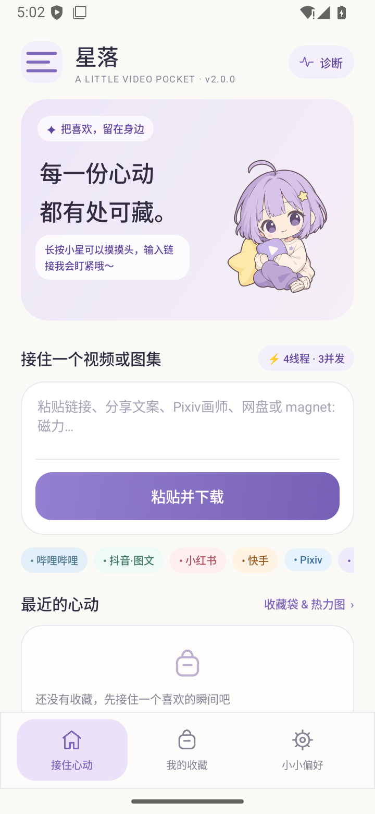
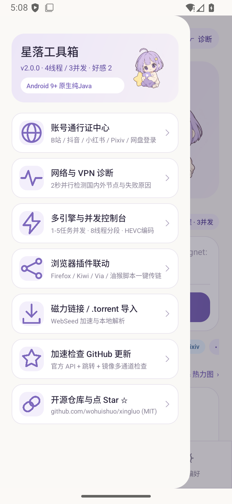
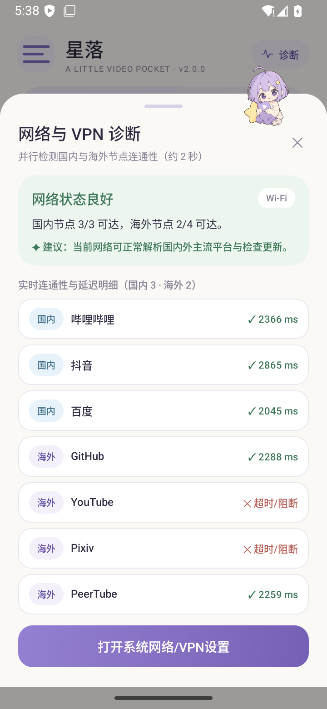
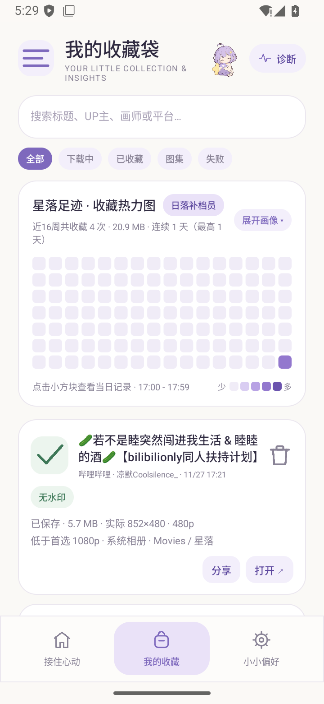

<div align="center">

<h1>✨ 星落 Xingluo v2.0.0</h1>

<p>
  <strong>可愛、輕量、開源的 Android 9+ 原生影片與圖文全能下載器</strong><br/>
  <sub>純 Java + OkHttp · 僅 4.45 MB（4.25 MiB）· 無廣告 / 無追蹤 / 本機 Cookie 隔離 · 會互動的小星夥伴</sub>
</p>

<p>
  <a href="README.md">简体中文</a> ·
  <a href="README.en.md">English</a> ·
  <a href="README.ja.md">日本語</a> ·
  <b>繁體中文</b> ·
  <a href="README.es.md">Español</a>
</p>

<p>
  <a href="https://github.com/wohuishuo/xingluo/releases/latest"></a>
  
  
  
  <a href="LICENSE"></a>
</p>

</div>

---

> **v2.0.0 全面進化**：正式升級支援 **Android 9 以上（`minSdk 28`）**，維持 4.45 MB 的輕巧體積與與 v1.2.0 相同簽名憑證（可直接覆蓋升級）。新增 1–8 執行緒分段續傳、1–5 任務並發、HLS/FLV 直播錄製、Pixiv 畫師主頁批次抓圖與 Tag 資料夾歸檔、純 Java 磁力與 WebSeed、網盤解析、手機瀏覽器擴充套件聯動、內建帳號登入修復、網路/VPN 診斷醫生，以及會眨眼互動的 **「活體小星」** 與 **16 週熱力圖**。

---

## 📸 介面預覽

<table>
  <tr>
    <td align="center" width="25%"><br/><b>首頁與活體小星</b></td>
    <td align="center" width="25%"><br/><b>星落工具箱抽屜</b></td>
    <td align="center" width="25%"><br/><b>網路與 VPN 診斷</b></td>
    <td align="center" width="25%"><br/><b>收藏袋與 16 週熱力圖</b></td>
  </tr>
</table>

---

## ✨ 重點新功能與修復

- **完整回應社群意見 ([Issue #1](https://github.com/wohuishuo/xingluo/issues/1))**：修復輸入框有內容時貼上失效問題（新增一鍵清除與「貼上新連結」）、支援剪貼簿自動偵測、收藏卡片顯示真實檔案大小與解析度、支援單條刪除（僅移除紀錄或同步刪除檔案）、新增抖音圖文相簿與快手/小紅書/AI 分享頁解析、支援同時 1–5 任務與 8 執行緒分段下載，並於下載失敗時提供一鍵 **「診斷原因」**（並行偵測海內外節點連通性，提示是否需開啟 VPN 或登入帳號）。
- **Pixiv 畫師批次抓圖與智慧濾圖**：支援 `/users/<uid>` 畫師全部作品原圖下載至 `Pixiv/<作者>_<UID>/` 並附帶 Tag 檔名，自動過濾頭像、橫幅、小圖及可切換的 AI 標籤作品。
- **直播錄製 & 純 Java 磁力 & 瀏覽器外掛**：支援 HLS (`m3u8` / AES-128) 與 FLV 直播隨時「停止並儲存」為標準 MP4；免額外 C++ 函式庫支援 `.torrent` 與 `magnet:`；隨附 [browser-extension/](browser-extension/) MV3 擴充套件與油猴腳本 `xingluo-bridge.user.js`。
- **品質驗證**：通過 Android 16 模擬器實測（v1.2.0 覆蓋升級、16 項 UI 冒煙測試、抖音 `720×1280 H.264` 與 B站 `852×480 HEVC` 真實下載與 `ffmpeg` 全幀解碼驗證），及 `84 / 84` 單元測試全部通過。

## 🛠️ 本機建置

```bash
./gradlew :app:testDebugUnitTest
./gradlew :app:lintDebug :app:assembleDebug
```

詳細說明請見 [docs/release-2.0.0.md](docs/release-2.0.0.md) 與 [docs/OPEN_SOURCE_REFERENCES.md](docs/OPEN_SOURCE_REFERENCES.md)。採用 MIT 授權條款。
