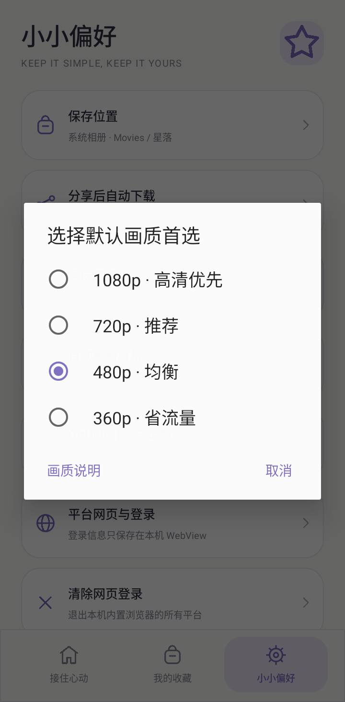
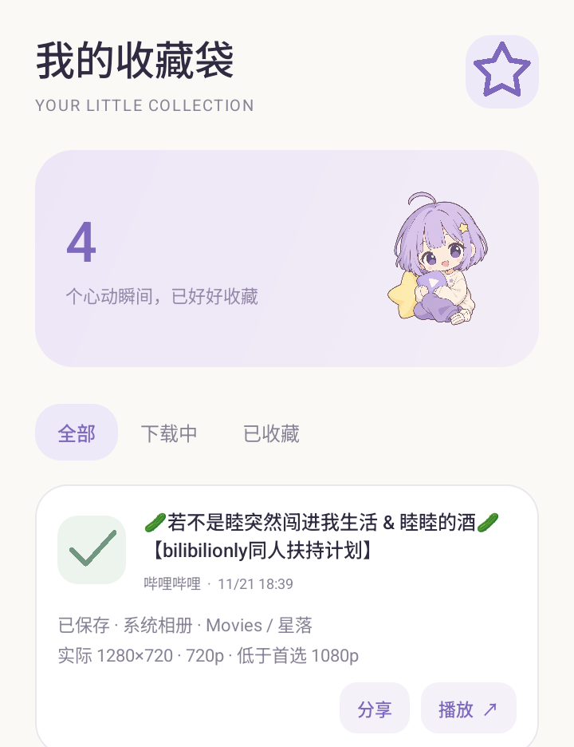
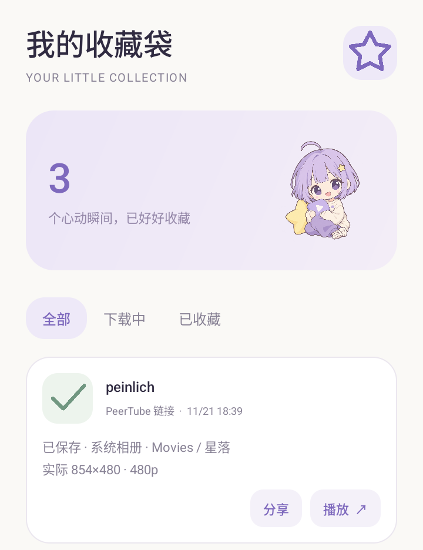

## 星落 Xingluo 1.2.0

同一条 B 站样本从 360p 提升到 720p。收藏袋新增实际文件分辨率，并在低于首选时显示提示。新版也支持符合条件的 PeerTube 链接。

### 相比 1.1.0

- **B 站回退保留画质首选。** MP4 回退请求会使用选定档位，试过一种格式仍失败时会继续检查另一种可用格式。横屏和竖屏都按短边比较清晰度。
- **抖音多档源优先比较分辨率。** 同一分辨率再比较码率，播放主地址带有宽高时也参与选源。
- **收藏袋显示实际宽高。** 画质来自保存文件的轨道信息。下载结果低于首选时会提示。分享已有文件时也会显示实际尺寸。
- **新增 PeerTube。** 支持公开播放、嵌入和短链接。仅处理作者开放下载、站点提供完整 MP4 的视频。同一档位的下载入口失效时，可使用站点接口给出的 MP4 地址。
- **兼容中文键盘输入的链接标点。** 能识别部分由全角冒号、斜线或句点组成的地址。

### Android 16 模拟器实测

下表是从模拟器取出保存文件后用 ffprobe 读到的数据。五份文件都通过了完整解码检查。

| 样本 | 版本与画质设置 | 实际尺寸 | 视频 / 音频 | 时长 |
|---|---|---|---|---|
| [同一条 B 站视频](https://b23.tv/y7xiWGg) | 1.1.0，首选 720p | 640×360 | H.264 0.65 Mbps / AAC 64 kbps | 62.10 秒 |
| 同一条 B 站视频 | 1.2.0，首选 720p | 1280×720 | H.264 1.16 Mbps / AAC 182 kbps | 62.10 秒 |
| 同一条 B 站视频 | 1.2.0，首选 1080p | 1280×720 | H.264 1.16 Mbps / AAC 182 kbps | 62.10 秒 |
| [抖音竖屏样本](https://www.douyin.com/video/6961737553342991651) | 1.2.0，首选 1080p | 720×1280 | H.264 1.51 Mbps / AAC 128 kbps | 19.73 秒 |
| [PeerTube 样本](https://tube.tchncs.de/w/sFhdfdsN1dbgy41XqRawdH) | 1.2.0，首选 480p | 854×480 | H.264 0.87 Mbps / AAC 192 kbps | 78.72 秒 |

B 站新旧版都首选 720p 时，这条样本从 640×360 提升到 1280×720。新版改选 1080p 后仍拿到 720p，并在收藏袋提示低于首选。不同链接、登录状态与网络环境都会影响可用源。

29 项单元测试与 12 项 Android 检查通过。Android 检查在签名正式版上运行，覆盖保存位置、音画合并、分享自动保存、任务恢复和实际分辨率显示。Android Lint 未报错误。

### 支持范围

- **B 站、抖音**支持可访问的公开视频分享链接。部分链接可能触发平台访问验证或 CDN 拒绝。
- **PeerTube**要求发布者开启下载，并提供完整 MP4。仅提供 HLS 等分片流的实例或视频暂不支持。
- **微信视频号**支持可访问网页暴露的实际 MP4，或在微信中已保存后分享到星落的文件。微信原生卡片、加密内容、DRM、直播和会员限制绕过暂不支持。

感谢 [Issue #1](https://github.com/wohuishuo/xingluo/issues/1) 的平台扩展建议。这一版先加入原生 PeerTube 支持。安装包仍使用安卓原生解析和合并流程，yt-dlp 及其运行时暂未集成。

### 安装与升级

1. 在下面的 **Assets** 中下载 **Xingluo-1.2.0.apk**，需要 Android 10 或以上。
2. 打开 APK 安装。如系统询问，允许用于打开安装包的应用安装外部应用。
3. 已安装 GitHub 正式版 1.1.0 时可直接覆盖升级。已验证两个版本的签名证书一致，并在 Android 16 模拟器上覆盖安装成功。
4. 在 **小小偏好 → 画质首选** 选择档位。下载完成后到 **我的收藏** 查看文件实际分辨率。

### 演示与截图

[竖屏演示 MP4](https://github.com/wohuishuo/xingluo/releases/download/v1.2.0/Xingluo-1.2.0-demo.mp4) · [截图 ZIP](https://github.com/wohuishuo/xingluo/releases/download/v1.2.0/Xingluo-1.2.0-screenshots.zip)

  

Xingluo 1.2.0 improves quality selection for Bilibili and Douyin, reports the actual saved resolution and adds PeerTube support when the creator enables downloads and the instance offers a complete MP4. Download the signed APK from Assets for Android 10 or newer.
