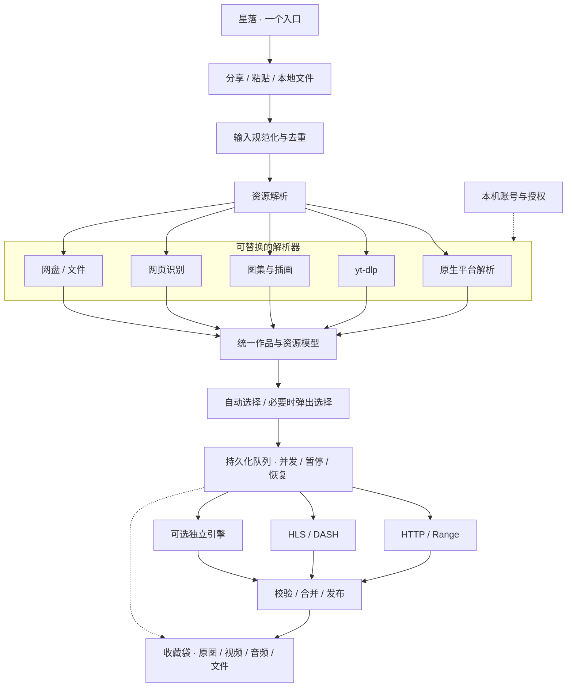
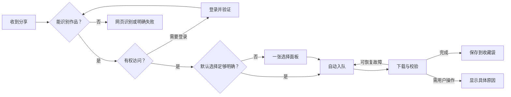
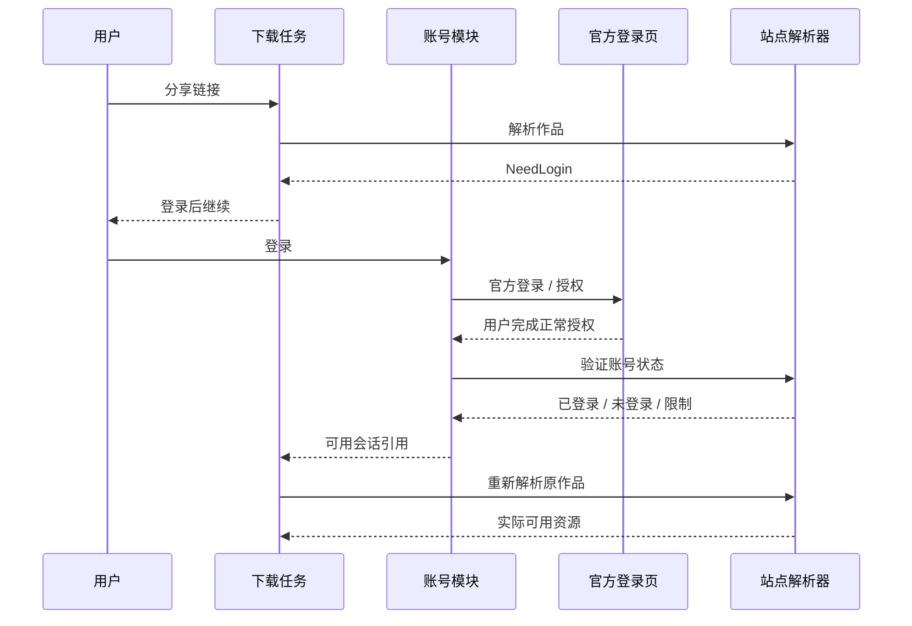
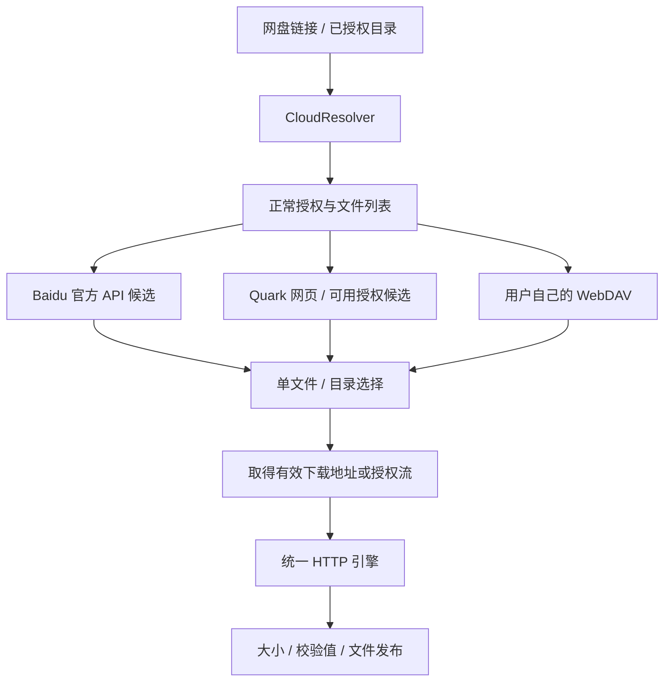
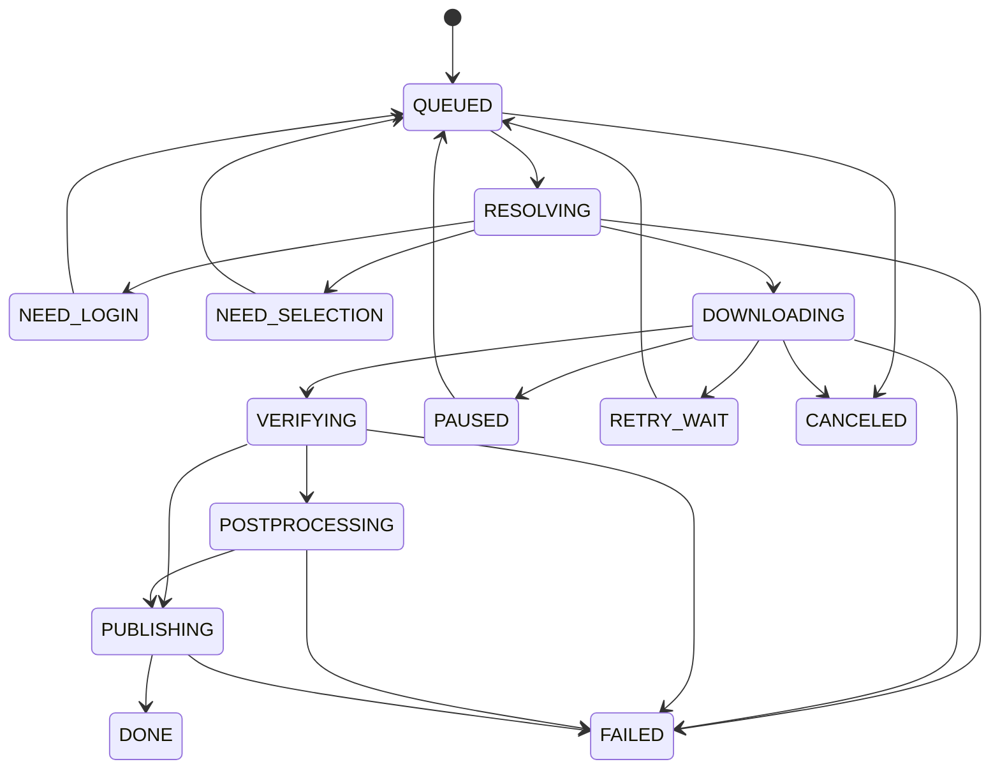
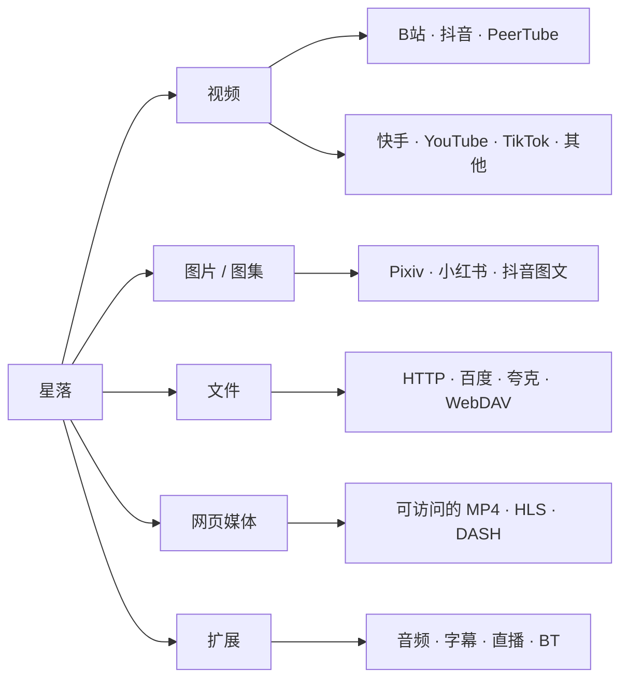

# 星落 Xingluo：万能下载器架构与实现方案

> 把喜欢的东西，放进口袋。分享给星落，自动下载。
>
> 设计稿 · 2026-11-24 · 基于 v1.2.0 / main 源码与 [Issue #1 用户反馈](https://github.com/wohuishuo/xingluo/issues/1#issuecomment-7089634433)。本文中的新模块、支持范围、测试指标均为待实现目标，不代表已发布能力。

## 1. 目标与约束

星落的产品定位不变：它不是浏览器、网盘客户端、命令行前端或专业剪辑工具，而是 Android 上一个统一的保存入口。

- 默认路径：其他应用分享作品链接、文字或文件 → 星落自动识别 → 自动选择合理资源 → 后台保存。直接粘贴也一样。
- 保留小星角色、首页、收藏袋、小小偏好、现有配色和轻量原生 UI；不为每个网站加入口，不让用户先选择下载引擎。
- 默认下载作品本身，而不是网页中全部资源。Pixiv 下载原图；抖音图文下载作品图片；视频页下载视频，不自动下载头像、背景、图标、封面、广告、推荐内容。
- 只有无法自动决定、需要登录、批量/文件夹需要确认或任务失败时才打开选择面板或网页。
- 优先本地执行，默认无中心服务器；不默认发送 URL、账号信息或 Cookie 给外部解析站。
- 优先保持星落自有代码 MIT。先选择成熟宽松许可代码；第三方依赖保留原许可，不能把所有依赖标记成 MIT。
- 保持 Android 10+（API 29）、现有 applicationId、签名升级兼容、历史收藏及保存位置。当前 Java 17 源码、JDK 21 构建、Groovy Gradle，不要求全项目迁移 Kotlin/Compose。
- 对正常可访问、可保存资源工作；不把 DRM、付费限制、验证码、账号权限或平台限速当成普通下载故障。

## 2. 现状：需要改动的具体文件

以下文件均位于 [app/src/main/java/app/xingluo/video/](https://github.com/wohuishuo/xingluo/tree/main/app/src/main/java/app/xingluo/video)。现有测试见 [test](https://github.com/wohuishuo/xingluo/tree/main/app/src/test) 和 [androidTest](https://github.com/wohuishuo/xingluo/tree/main/app/src/androidTest)。

| 现有代码 | 已确认的问题 / 限制 | 迁移方式 |
|---|---|---|
| MainActivity.java | 粘贴与当前输入混用；分享文件及播放/分享 MIME 主要是视频；分享后进入收藏袋 | 保留 UI，拆分粘贴和提交；统一 share intent；使用通用文件操作 |
| LinkInput.java | 平台枚举有限，主要抽取单 URL | 增加多个链接提取、规范化、资源分类；保留旧接口过渡 |
| Resolver.java | 平台分支集中，返回单一 MediaPlan | 将 B站/抖音/PeerTube 拆成独立 Resolver 实现；原方法作为兼容层 |
| MediaParser.java | 视频结构为中心；抖音仅视频树搜索；已有排除 avatar/cover 等逻辑 | 保留已验证的解析与质量选择；扩展结构化作品图片与资源角色 |
| MediaPlan.java | 标题、视频及音频 URL/备用地址；无法表达作品图集、文档或目录 | 用 ResolvedWork / Asset / Variant / DownloadPlan 替代，旧 plan 做适配 |
| DownloadService.java | 第 15 行单线程执行器；下载、重试、合并、保存耦合 | 保留前台服务入口，迁出调度、执行与发布逻辑 |
| Net.java | 单连接写文件；WebView CookieManager；手工重定向 | 保留安全 URL 检查及域限制；接入统一 HTTP 传输与认证策略 |
| TaskStore.java | SharedPreferences 全量 JSON；恢复时将活动任务标失败；终态最多保留 100 条 | SQLite 事务，迁移现有记录；支持检查点、暂停、单项删除 |
| BrowserActivity.java | 正常网页 Cookie 可用，但缺少账号状态验证；找到媒体即提交并关闭 | 分离登录、资源发现、手动重试三种模式 |
| MediaFiles.java | 仅 MP4；SAF 发布用共享 pending 键，不能安全并发 | 每任务发布日志、按 MIME 发布、原图/文件保留原格式 |
| Preferences.java / Ui.java / VideoQuality.java / RetryPolicy.java | 已有偏好、视觉组件、画质规则、有限重试 | 保留，扩展最少必要配置与可分类错误 |

先把已有测试固定住，再做结构迁移。不得为了引入新引擎删除已经能正常工作的 B 站、抖音和 PeerTube 路线。

## 3. 总体架构





结构原则：解析器负责回答“这个链接包含什么”；选择器负责“保存什么”；执行器负责“如何拿到字节”；发布器负责“如何保存到手机”。UI 只提交意图和观察状态，不直接决定平台协议。

## 4. 问题 → 多个不完美的方案 → 结果

| 问题 | 方案 A | 方案 B | 方案 C | 选择及结果 |
|---|---|---|---|---|
| 网站数量太多 | 全部自己写：轻但维护贵 | 只用 yt-dlp：覆盖广但不擅长所有图文 | 多解析器：适配层有成本 | 原生优先 + yt-dlp + 图集解析；每站可独立修复 |
| Python 在安卓运行 | GPL 封装：快，授权影响 | Chaquopy：APK 增大、兼容需验证 | 服务端：依赖网络与隐私 | 本地 Chaquopy 按需启动；原生能力无 Python 也能运行 |
| 单线程下载慢 | 只扩大线程池：竞态及限速 | 移植 AB DM 整个核心：依赖链较大 | OkDownload/Fetch：老项目兼容需验证 | HTTP 引擎先做 OkDownload 门槛实验；保留单连接回退 |
| 所有引擎都管理队列 | 直接让各 SDK 自行调度：状态不同 | 重写所有传输：浪费 | 一个总队列 + 引擎只执行分配的任务 | 一个任务数据库；各引擎可取消、检查点可恢复 |
| 网页误下头像背景 | 抓所有图片：噪声大 | 按尺寸过滤：误删小图 | 作品 API/DOM 语义 + 保守规则 | 只自动下载 PRIMARY 资源；不确定才让用户选 |
| 登录失败 | 用户导入 Cookie：难用 | WebView 网页打开即算登录：当前问题 | 官方登录 + 账号验证 + 授权绑定 | 小小偏好账号列表、按任务唤起；不保存账号密码 |
| HLS/DASH | 自写分片全部逻辑：易漏格式 | yt-dlp 完整下载：可能要 FFmpeg | AndroidX Media3 + 明确导出适配 | 先支持有限的非 DRM VOD；格式不兼容才考虑经过审计的工具链 |
| 百度/夸克网盘 | 自己复刻私有协议：易失效 | 内嵌 OpenList：AGPL、Go 运行时 | 官方接口/独立 WebDAV 服务 | 官方优先，用户自己的 OpenList 可选；不承诺所有分享链接 |
| 复杂选择 | 每次弹窗：破坏一键下载 | 永远自动：误选图集/大目录 | 默认自动，歧义时轻量选择 | 一个底部面板，不新增一堆平台页面 |
| 新版本维护 | 复制全仓库后永久分叉 | 远程动态下载任意代码 | 固定版本依赖、可重现升级 | 依赖锁定、测试、随签名 APK 更新；不执行未经签名脚本 |

## 5. 源码复用清单（给开发者与 Codex）

### 5.1 规则

- **引入依赖**：原样使用库，而不是把整个仓库复制进来。固定发行版本和依赖校验值。
- **移植**：从已审计文件复制必要代码/算法，保留版权、LICENSE、NOTICE 和修改记录；Go/Python 到 Java 只移植需要的纯数据与解析部分。
- **参考**：阅读设计和测试，独立实现接口；不粘贴不兼容许可代码。
- **外部**：明确独立部署的工具/服务，通过标准接口连接。不假设独立进程一定能解除 GPL 义务。
- 以下路径来自本次实际获取的上游目录树或源文件；上线前 checkout 到具体 commit 并重新审核文件与传递依赖。目录路径存在 ≠ 代码已经编译或实测可用。

### 5.2 首批可复用模块

| 优先级 / 上游 | 已核查的源码位置 | 复用方式 / 星落目标文件 | 验收 |
|---|---|---|---|
| P0 [OkDownload](https://github.com/lingochamp/okdownload) · Apache-2.0 | `okdownload/.../DownloadTask.java`；`core/dispatcher/DownloadDispatcher.java`；`core/download/DownloadCall.java`、`DownloadChain.java`、`DownloadStrategy.java`；`core/file/MultiPointOutputStream.java`；`okdownload-breakpoint-sqlite/.../BreakpointStoreOnSQLite.java` | 先以依赖集成 HTTP 引擎；如构建不兼容，移植经过依赖分析的核心子模块与测试；`engine/http/OkDownloadEngine.java` | 206 校验、暂停、重启、变更 ETag、未知长度、Android 29/35/36 |
| 备选 [Fetch](https://github.com/tonyofrancis/Fetch) · Apache-2.0 | `fetch2/.../downloader/ParallelFileDownloaderImpl.kt`、`SequentialFileDownloaderImpl.kt`、`DownloadManagerImpl.kt`、`FetchConfiguration.kt`；`fetch2okhttp/.../OkHttpDownloader.kt` | OkDownload 实验失败后才选；`engine/http/FetchEngine.java`，总队列仍属于星落 | 同一套传输合同测试；不同时引入两个生产 HTTP 引擎 |
| 参考 [AB Download Manager](https://github.com/amir1376/ab-download-manager) · Apache-2.0 | `android/app/src/main/kotlin/com/abdownloadmanager/android/pages/browser/DownloadInterceptor.kt`、`WebView.kt`；`pages/add/multiple/` | 阅读多任务与浏览器接管；必要时复制小段；不复制 Compose UI、不迁移整个 Kotlin 项目 | 分享即下载；没有重复任务管理 |
| P0 [Chaquopy](https://github.com/chaquo/chaquopy) · MIT（另审 Python 等许可） | `product/gradle-plugin/`、`product/runtime/` | Gradle 插件 + 固定 Python 运行时；`app/src/main/python/`；保留原生模式 | ABI、AGP/JDK/SDK 兼容；冷启动、APK 大小和内存报告 |
| P0 [yt-dlp](https://github.com/yt-dlp/yt-dlp) · 源码 Unlicense（发行物另审） | `yt_dlp/YoutubeDL.py`、`cookies.py`、`extractor/bilibili.py`、`tiktok.py`、`xiaohongshu.py`、`weibo.py`、`peertube.py`、`generic.py`、`extractor/youtube/` | 固定源码/wheel；通过 `ytdlp_bridge.py` 的 extract_info(download=False) 转换结构化 JSON；不能把单个 extractor 当独立文件复制 | 原生失败后的真实站点测试，视频轨道/headers/失效 URL 可正确映射 |
| P0 [yt-dlp-android MIT 封装](https://github.com/ffmpegkit-maintained/yt-dlp-android) · MIT | `library/src/main/python/ytdlp_runner.py`；`library/src/main/java/dev/ffmpegkit_maintained/ytdlp/YtDlp.java`、`YtDlpRequest.java`、`DownloadProgressCallback.java`；`library/build.gradle` | 复用 Java/Python 桥接思路及必要 MIT 代码；`resolver/ytdlp/PythonRuntime.java`、`YtDlpResolver.java`；重写 runner 的结构化解析和取消边界 | 当前 runner 主要调用 download、忽略未知 flag、吞回调异常，不直接当生产引擎；取消测试必须过 |
| P0 [F2](https://github.com/Johnserf-Seed/f2) · Apache-2.0 | `f2/apps/douyin/filter.py`、`model.py`、`handler.py`；`f2/apps/tiktok/`、`f2/apps/weibo/` | 优先移植结构化作品字段、图文过滤和测试；`resolver/nativeplatform/DouyinResolver.java`、`WeiboResolver.java`；不整包复制 CLI/爬虫/签名算法 | 1/N 图文、带视频图文、头像/封面排除、删除/不可访问作品 |
| P0 [Lux](https://github.com/iawia002/lux) · MIT | `extractors/kuaishou/kuaishou.go`、`kuaishou_test.go`；`extractors/douyin/`、`extractors/bilibili/` | 只移植普通公开作品的 URL 分类、响应结构解析、fixture 断言；`resolver/nativeplatform/KuaishouResolver.java` | 真机分享短链与标准链接；登录/限制清晰返回 |
| P1 [PixivPy](https://github.com/upbit/pixivpy) · Unlicense | `pixivpy3/aapi.py`、`api.py`、`models.py`、`utils.py`、`download_illusts.py` | 优先验证正常网页登录作品页；有受支持授权时评估依赖的作品详情与图页枚举，或移植字段映射；`resolver/image/PixivResolver.java` | 单图/多图/原图/顺序/不含头像；无可用授权不伪造客户端身份 |
| P1 [MediaGo](https://github.com/mediago-dev/mediago) · MIT | `apps/core/internal/service/m3u8_inspector.go`、`discovery_download.go`；`packages/browser-extension/src/site-adapters/bilibili/adapter.ts` | 参考或移植清单分类与网页资源筛选中经过许可核查的独立逻辑；`resolver/web/WebResourceClassifier.java`、`engine/stream/ManifestInspector.java` | 多码率清单；只发现当前作品；不把 blob: 当下载地址 |
| P1 [AndroidX Media3](https://github.com/androidx/media) · Apache-2.0 | 官方 HLS/DASH、Extractor、Transformer API | 使用固定版本依赖；`engine/stream/Media3StreamEngine.java`、`media/MediaPostProcessor.java` | 明确支持容器/编码/分片组合；导出普通可播放文件，而不是仅缓存播放 |
| P1 [OpenList](https://github.com/OpenListTeam/OpenList) · AGPL-3.0 | `drivers/baidu_netdisk/driver.go`、`types.go`、`util.go`；`drivers/quark_uc/driver.go`、`util.go`；`drivers/quark_open/driver.go`；`internal/driver/driver.go` | 只阅读驱动边界与 List/Link；不复制 Go 驱动进 MIT app；可连接用户独立部署的 WebDAV；`resolver/cloud/WebDavResolver.java` | 自有网盘授权/目录读取/下载一致；不要求星落用户自行部署才能使用基础功能 |

上游源码路径中的 `...` 表示省略中间 Java/Kotlin package，不能直接作为文件路径。开工时用 `git ls-tree -r HEAD --name-only` 定位完整路径。

### 5.3 第二批参考与许可分流

| 上游 | 作用 | 决定 |
|---|---|---|
| [Seal](https://github.com/JunkFood02/Seal)、[YTDLnis](https://github.com/deniscerri/ytdlnis)、[youtubedl-android](https://github.com/yausername/youtubedl-android) | Android 下载任务、Python/FFmpeg、进度及日志 | GPL-3.0；MIT 发行路线下只参考设计，不内嵌代码 |
| [gallery-dl](https://github.com/mikf/gallery-dl) | 图片站点、图集、元数据、文件命名 | GPL-2.0 系列；当前活跃开发已迁 Codeberg，参考行为和测试，不直接复制 |
| [KS-Downloader](https://github.com/JoeanAmier/KS-Downloader)、[XHS-Downloader](https://github.com/JoeanAmier/XHS-Downloader)、[TikTokDownloader](https://github.com/JoeanAmier/TikTokDownloader) | 专门站点覆盖 | GPL 项目按文件核查；MIT 版本只参考；优先 Lux/F2/yt-dlp |
| [Cobalt](https://github.com/imputnet/cobalt)、[Cat Catch](https://github.com/xifangczy/cat-catch) | 解析路由、浏览器发现 | 不直接复制未经许可核查的代码；浏览器扩展 API 不等价 Android WebView |
| [N_m3u8DL-RE](https://github.com/nilaoda/N_m3u8DL-RE) | 分片、音视频轨道与清单 | MIT；仅考虑非 DRM 清单与传输部分，C# 运行时不进入首版 APK |
| [FFmpeg](https://github.com/FFmpeg/FFmpeg) | 封装/转码/音轨合并 | LGPL/GPL 取决于具体构建；首选现有 Android MediaMuxer/Media3，不复制未知二进制 |
| [aria2](https://github.com/aria2/aria2)、[Gopeed](https://github.com/GopeedLab/gopeed) | 多协议、大文件和种子 | GPL 系列；若以后需要独立工具，先审计发布与 IPC 边界 |
| [Streamlink](https://github.com/streamlink/streamlink) | 直播流 | BSD-2-Clause；以后选配直播；不在首版引入无限流 |
| [jLibtorrent](https://github.com/frostwire/frostwire-jlibtorrent)、[rclone](https://github.com/rclone/rclone) | BT / 云服务 | 后续评估依赖、ABI、许可及移动端资源消耗 |

不要为了覆盖数量而同时集成重复引擎。先用测试证明某个组件解决当前问题，再引入它。

## 6. 目录结构与接口（目标结构，不是要求一次拆完）

首期保持单一 app Gradle module，用 package 隔离即可；只有 Python 或原生库构建需要时才增加 Gradle module。

```text
app/src/main/
  java/app/xingluo/video/
    MainActivity.java              # 原样式、输入和任务观察
    Ui.java                       # 保留
    BrowserActivity.java          # 正常登录/网页发现
    DownloadService.java          # Android 前台服务入口
    input/                        # ShareInput, LinkNormalizer
    model/                        # Work, Asset, Variant, DownloadPlan
    resolver/                     # ResolverRegistry, ResolveResult
      nativeplatform/             # Bili, Douyin, PeerTube, Kuaishou
      ytdlp/                       # PythonRuntime, YtDlpResolver
      image/                      # Pixiv, XHS ...
      web/                        # WebResourceClassifier, BrowserResolver
      cloud/                      # Baidu, Quark, WebDAV
    auth/                         # AccountRegistry, AuthSession, CookiePolicy
    policy/                       # AssetSelector, QualityPolicy, NamingPolicy
    queue/                        # TaskCoordinator, TaskRepository, Checkpoint
    engine/
      http/                       # HttpEngine, OkDownload adapter
      stream/                     # HLS/DASH
      local/                      # content:// import
      external/                   # optional external engine contracts
    media/                        # MediaPostProcessor, Validator
    storage/                      # TempStore, Publisher, PublicationJournal
    ui/                           # Optional selection sheet, account list
  python/
    xingluo_ytdlp_bridge.py         # Python structural extraction only
  assets/third_party/              # licenses and notices
docs/
  universal-downloader-architecture.md
  upstream-reuse.yml
  support-matrix.md
  test-results/
```

### 6.1 解析合同

Java 伪代码，签名作为实现约定；不是直接可编译文件。

```java
interface Resolver {
    boolean accepts(InputRef input);
    ResolveResult resolve(InputRef input, ResolveContext ctx);
}

sealed interface ResolveResult {
    record Success(ResolvedWork work) implements ResolveResult {}
    record NeedLogin(String provider, String reason) implements ResolveResult {}
    record NeedSelection(ResolvedWork work) implements ResolveResult {}
    record Unsupported(String reason) implements ResolveResult {}
    record Failure(ErrorCode code, boolean retryable) implements ResolveResult {}
}

record ResolvedWork(
    String provider, String workId, String canonicalUrl,
    String title, List<Asset> assets
) {}

record Asset(
    String id, MediaKind kind, AssetRole role, int order,
    String groupId, List<Variant> variants
) {}

record Variant(
    String id, Protocol protocol, String mime, String extension,
    List<String> candidateUrls, int width, int height, long size,
    String codec, String language, String requestProfileId,
    long expiresAtEpochSeconds
) {}
```

- AssetRole：PRIMARY、COVER、AVATAR、BACKGROUND、THUMBNAIL、SUBTITLE、RELATED、UNKNOWN。默认只保存 PRIMARY。
- MediaKind：VIDEO、IMAGE、AUDIO、FILE、SUBTITLE、ANIMATION；Protocol：HTTP、HLS、DASH、LOCAL、EXTERNAL。
- 一个作品可以有多张图片；同一图片可以有多个尺寸 Variant；视频的独立音轨与画轨通过 groupId 关联，而不是被误判为两份用户作品。
- 未知大小、有效期、编码应显式标记未知，不猜测。下载地址和请求授权只在任务内存或受保护短期缓存中使用，不能当永久收藏 ID。
- 数据库长期保存 provider/workId/assetId、原始分享 URL（按隐私策略）、任务状态和文件 URI；带令牌的临时 CDN URL 默认不永久保存。
- 解析结果限制资源数、分页深度及字符串长度；图集大于设定阈值（首期建议 30 张）弹选择，不自动下载整个作者主页。

### 6.2 执行合同

```java
interface DownloadEngine {
    boolean supports(TransferSpec spec);
    TransferResult run(TransferSpec spec, Checkpoint checkpoint,
                       Cancellation cancel, ProgressSink progress);
}

interface AccountProvider {
    LoginState verify(SessionRef session);
    RequestProfile authorize(URI target, SessionRef session);
    void logout(SessionRef session);
}

interface Publisher {
    PublishedFile publish(VerifiedFile file, Destination destination,
                          String taskId, Cancellation cancel);
}
```

TransferSpec 是单个实际传输单元；DownloadPlan 负责组合、轨道依赖、存储位置、质量策略。所有引擎必须报告已接收字节、总量（若已知）、速度和可恢复性；不能把“已获取 URL”或“缓存播放成功”报告为完成。

队列持有唯一 taskId，重试用 attemptId，工作文件用 taskId/assetId/attemptId。每次重试先取消并等待旧 attempt 释放写句柄；旧回调不能覆盖新状态。不要把未经审计的 Python/Go 回调直接暴露给 Activity。

## 7. 解析路由与图片选择

### 7.1 路由

1. 直接文件分享（content://）：导入本机，不发送网络。需要临时授权时立即在允许的生命周期内复制到私有暂存或持久化允许的 URI 权限。
2. HTTP(S) 链接分类：站点作品 → 原生解析器；网盘链接 → CloudResolver；普通文件 → DirectFileResolver；其他 → yt-dlp Generic/站点解析。
3. 已知站点原生解析只在 Unsupported、可恢复解析错误或结果缺少目标资源时回退 yt-dlp；NeedLogin 和明确权限限制不能被吞掉再盲试。
4. 图文由专门结构化解析器优先处理。yt-dlp 返回视频但缺图，不应标记整个图文作品解析成功。
5. 无结果时显示网页识别入口。没有用户授权不能自动跳转第三方 PeanutDL 或泄漏分享 URL；现有入口若保留，单独显式告知。
6. 选定结果交给选择器；禁止解析器自行启动下载服务。

同一作品/账号/质量选项的短期解析结果可以缓存；短链接缓存必须考虑跳转失效，不能缓存登录失败和过期签名。相同链接同时解析合并为一个 in-flight 请求，用户取消一个任务不应取消其他订阅者。

### 7.2 作品本身，不是网页全量资源

| 输入 | 默认保存 | 明确排除 / 选择 |
|---|---|---|
| Pixiv artworks/{id} | 当前作品全部原图，按页序 | 作者头像、推荐插画、缩略图、背景；动图原始合法资源支持单列实验 |
| 抖音/小红书图文 | 当前作品 PRIMARY 图片原图；若结构化作品包含真实视频，一并列入 | 音乐作为可选附属资源；头像、封面、评论图不保存 |
| B站视频 | 默认质量下的画轨+音轨或完整 MP4 | 封面、弹幕、字幕、其他分P默认不保存；字幕/其他分P可选 |
| 普通网页 | 有明确 video/source、主要正文图集或合法媒体清单才自动选 | CSS 背景、srcset 重复候选、广告、tracking pixel、导航图标 |
| AI 作品页 | 当前用户可访问且平台提供的原始导出资源 | 不删除水印、不承诺未公开原图、不抓账号页面其余作品 |
| 网盘文件/目录 | 单文件直接保存；文件夹/多文件先选择 | 不自动转存、上传、删除或下载整个账号目录 |

通用网页识别优先 DOM 语义（main/article/当前作品容器）、媒体元素、作品元数据与源地址证据；尺寸仅作为排序信号，不能用“图小就丢弃”作为唯一规则。候选只在当前页面导航会话有效，不跨页面保存。blob: 是浏览器本地引用，不是 HTTP 下载地址；识别正常页面实际可访问的原始媒体或提示不支持。

Android WebView 的 shouldInterceptRequest 与浏览器扩展 webRequest 不等价：并非所有请求、重定向、播放器内部数据都可见。不能承诺网页所有资源都能发现。仅向可信页面注入固定只读 DOM 检测脚本，不把任意网页连到高权限 JavaScript bridge。

## 8. UI：保持一个下载入口

```text
┌─────────────────────────┐
│ 星落 ✦          小小偏好 │
│  把喜欢的东西放进口袋     │
│  [粘贴链接 / 分享文案]    │
│       [粘贴并下载]       │
│  最近心动               │
│  图集 · 4/6 张     65%  │
│  视频 · 下载中    3 MB/s│
│  文件 · 等待中           │
│ 首页       收藏袋    偏好 │
└─────────────────────────┘
```

保持现有视觉，新增功能收纳在三个地方：

- 首页：按钮始终读取当前剪贴板；手工输入非空时可使用输入框独立提交动作。系统分享直接排队，默认不要求额外确认。
- 收藏袋：一个父任务可以展开图集/视频分P/目录文件；现有卡片加入类型图标、速度、暂停/继续、取消、单条删除；打开/分享使用真实 MIME。单条删除默认只删记录，删除本地文件需明确选择。
- 小小偏好：画质、保存位置、自动下载（默认开）、仅 Wi-Fi（可选）、最大同时任务（默认 3）、账号、可选网盘连接。高级引擎配置隐藏在折叠区，不把 yt-dlp 参数暴露给普通用户。

选择面板只在需要时出现：图集可勾选每张；视频可选质量/音频/字幕；网盘目录显示文件名、大小、选择项；默认 PRIMARY 预勾选，附件不勾选。“下载选中项”一个主按钮。正常单视频/单图分享不经过该面板。账号登录独立轻量网页，不在首页罗列网站登录按钮。

## 9. 登录：修复“能打开网页，但实际上没登录”

现有 BrowserActivity 会 CookieManager.flush()，Net 会按 URL getCookie()。这并不能证明 B站账号已登录、目标接口接受该会话、当前内容权限或画质有效；新 Python 引擎也不会自动共享 WebView Cookie。

### 9.1 统一账号流程



- B站：首先用当前正常 WebView 会话访问账号状态接口（如站点当前公开使用的 nav 账号信息接口），验证 isLogin、账号标识等；然后验证同一作品下解析和实际媒体请求的权限及可用档位。cookie 写入后等待验证结果，不以页面跳转作为登录完成。
- Pixiv：优先正常网页登录可访问作品页；官方/受支持 OAuth 授权可用时再用 PixivPy。用户主动完成账号验证；没有合适授权流程时保留网页模式并显示限制。
- 百度：优先官方开放平台 OAuth，作用域只读；正常回调、令牌刷新与登出验证。第三方应用注册、配额、授权条件必须实测。
- 夸克：优先正常网页/受支持授权与下载动作；无可靠授权 API 时先做网页导出或用户 WebDAV 接入。
- 多账号首版每个平台只保留一个活动账号（WebView CookieManager 不是多账号隔离容器）。未来需要隔离时单独设计 profile，不能假装切换一个 accountId 就隔离 Cookie。

### 9.2 跨引擎请求授权

Java HTTP 客户端按目标域匹配 Cookie 和 Referer，重定向到新域时重新计算，绝不照搬原域 Authorization/Cookie。Python 解析使用限定到相关站点的会话输入；如必须使用临时 cookiefile，只使用本机允许的已授权 cookie、私有路径、正确的 domain/path/Secure/expiry 语义，任务结束立即清理。

CookieManager.getCookie 返回请求头字符串，并非完整 cookie jar，不能据此猜测 HttpOnly、过期时间、host-only、partition 属性或把所有 Cookie 填成任意域。若无法安全表达会话，保留 WebView/原生执行路线。凭据由 Android Keystore 管理的加密存储保护；日志、异常、测试 fixture、崩溃报告、下载卡片不包含 token/Cookie/临时签名 URL。退出账号取消或暂停相关会话任务并清理对应凭据；清除全站网页登录与退出单站分开说明。

测试：未登录→登录→杀进程重启→校验已登录→下载；过期/退出→NeedLogin；账号 A 的 Cookie 不发给 B 或 CDN 非允许域；账号验证成功但资源不可用时显示具体权限问题。禁止自动提交密码、破解验证码和伪造授权客户端身份。

## 10. 百度网盘与夸克网盘

首先把网盘文件当普通文件，不与视频格式绑定。



| 能力 | 百度网盘 | 夸克网盘 | 首期验收条件 |
|---|---|---|---|
| 已登录用户自己的文件 | 官方 OAuth 与文件列表/下载接口候选 | 正常网页登录及下载；授权接口需核实 | 用户有访问权，下载普通文件并校验 |
| 公开分享链接 | 正常访问分享页；提取码由用户填写；官方能力待验证 | 同左 | 能正常下载的分享页；不能下载则打开官方页面 |
| 文件夹 | 文件列表与分页 | 同左 | 用户确认选中范围，逐文件下载 |
| 大文件 | 正常允许的地址刷新、Range、恢复 | 同左 | 1 GiB+，服务端不允许 Range 时退回顺序 |
| 通过 OpenList | 独立 WebDAV/标准接口 | 同左 | 测试用户授权配置，不把账号密码交给公共实例 |

[OpenList 百度驱动](https://github.com/OpenListTeam/OpenList/tree/main/drivers/baidu_netdisk)、[夸克驱动](https://github.com/OpenListTeam/OpenList/tree/main/drivers/quark_uc)、[Quark Open 驱动](https://github.com/OpenListTeam/OpenList/tree/main/drivers/quark_open) 已包含 List 和 Link 边界，可研究接口职责。其 [Quark 文档](https://doc.oplist.org/guide/drivers/quark) 明确提示 Open 并非真正公开开放接口。因此不把它视作可稳定注册的官方 API，不复制 AGPL 驱动。

百度官方入口：[百度网盘开放平台](https://pan.baidu.com/union/)。实施前通过当前开放平台说明确认应用登记、OAuth 回调、文件列表与下载权限；若官方 API 只能访问授权的应用目录或文件范围，不宣称能访问任意分享。不得通过他人的 AppID、令牌、会员账号或绕过限速解决问题。

WebDAV 是可选连接，不是全体用户必须部署的后端。支持 HTTPS、用户明确输入服务地址、证书校验、只读列表、按授权下载；目录路径防穿越、不自动扫描全盘。若地址刷新不保证对象版本相同，不能接着旧文件写。若正常下载只能由官方 App 完成，展示打开官方 App，不做虚假成功。

## 11. 下载执行与速度

### 11.1 先保证正确，再提高并发

现有单线程直接换成 fixedThreadPool 不够：任务状态、MediaFiles 的共享 pending 键、前台服务计数、取消和磁盘发布都要先并发安全。

| 限制 | 初始默认值（待基准测试） |
|---|---|
| 同时作品任务 | 3，可设置 1–5 |
| 同时解析 | 2；Python 初期串行，冷启动按需 |
| 每主机网络连接 | 4；服从 Retry-After 和站点策略 |
| 单个大 HTTP 文件分块 | 支持 Range 且 ≥16 MiB 时从 2–4 块试验；小文件 1 块 |
| 全局活跃传输连接 | 8，视频/音轨/分片均计入 |
| 合并/转码 | 同时 1 个，避免热量/内存过高 |
| 自动重试 | 保留最多 3 次总解析尝试；传输重试独立且有总预算 |

所有参数是起始值而不是平台保证。多个文件和一个文件内部多连接是两个独立维度；全局许可避免 3 个任务×8 个分片失控。对 429/Retry-After 等限制降低并发并等待，不通过切换身份或代理绕过。小图片图集重用连接、减少重复解析比每张图再开四条连接更有效。

### 11.2 HTTP 恢复条件

- 使用 GET Range 小范围探测；HEAD 可选，不能仅靠 Accept-Ranges 判断。
- 206 必须检查 Content-Range 起止及完整长度；Range 被忽略返回 200 时停止分块，清理旧片并从头单连接下载。
- 持久化分片区间、已完成字节、ETag/Last-Modified、预计长度和资源版本；有强校验依据才拼接；变化或不可信时重下。
- 416 判断是否本地已完整、对象缩短或版本变化；不能盲标完成。
- 若临时 URL 过期，重新解析原作品，只在同一资源 ID、版本/长度等验证成立时复用部分字节。
- 空间不足、目录权限丢失、网络关闭、用户暂停和取消分别处理。取消应及时关闭网络流与文件；暂停保留检查点。所有长度用 long。
- TLS、URL scheme、重定向链、主机及请求头须验证。默认仅访问 HTTP(S) 公共链接，拒绝外部链接诱导访问本机服务/内网；用户主动配置的 WebDAV 私有地址例外并明确授权。

### 11.3 HLS / DASH 与后处理

阶段一仅非 DRM 点播：先解析 master/MPD，选择不超过首选的合理档位，下载初始化段、媒体段与音轨，校验时间顺序和缺片，处理相对 URL 与正确 MIME。Media3 的离线下载缓存不是可分享的 MP4；只有完成实际导出并验证可播放才报告成功。

明确记录首期支持容器、轨道和分片格式。现有 MediaMuxer 可处理的 MP4 继续使用；不支持的容器返回明确错误或引入经审计的 Media3/FFmpeg 后处理。原图、音频、普通文件默认保留原格式，不无意义转码。受保护清单、DRM、无限直播先不做。

### 11.4 Android 后台

API 29–33 使用用户主动启动的现有前台服务并保存检查点；API 34+ 实验 User-Initiated Data Transfer Job（UIDT），适用于分享触发的长传输；较短可中断工作才考虑 WorkManager。所有执行入口共享数据库，不能重复调度同一任务。

当前 targetSdk 35；Android 15+ 的 dataSync/mediaProcessing 后台前台服务存在各自 24 小时窗口累计 6 小时限制。实现 onTimeout 持久化并停止，系统不允许启动时状态变为可恢复等待；Android 16 的后台 job 配额同样测试。参考 [UIDT](https://developer.android.com/develop/background-work/background-tasks/uidt)、[FGS timeout](https://developer.android.com/develop/background-work/services/fgs/timeout)。不以规避系统电量机制作为速度优化。

## 12. 任务持久化与文件一致性

推荐先用 Android SQLiteOpenHelper（项目纯 Java，不需要重 ORM）；如果后续需要 Room 再做迁移。SQLite 事务是当前阶段所需的最小数据库能力。



实际实现还应允许所有非终态取消、可恢复失败重试、系统停止转为 PAUSED/等待，以及账号失效转 NEED_LOGIN。任何迟到进度都不能修改终态。

数据库最少四张表：

| 表 | 字段要点 |
|---|---|
| tasks | taskId、canonicalKey、provider、sourceRef、accountRef、state、attemptId、quality、destination、错误码、时间 |
| assets | assetId、taskId、kind、role、ordinal、实际 MIME、bytes、state、最终 URI、校验结果 |
| checkpoints | assetId、区间、已写字节、对象版本、部分文件路径、重试预算 |
| publications | assetId、pendingUri、目标类型、提交阶段、finalUri |

任务入队和去重原子执行；保存位置在任务建立时快照，后续偏好变化只影响新任务。进度可 300–500ms 合并写入，关键状态/检查点事务提交。启动时恢复非终态而不是全部标失败；无检查点的任务回到解析。历史 SharedPreferences 数据迁移需幂等，校验数量和 URI 后标记完成，升级后旧收藏仍可播放。

每个资产使用独立暂存路径、文件大小和名称冲突处理。MediaStore 使用正确 collection/MIME 以及 IS_PENDING；SAF 用逐资产 publication journal，失败清理对应 pending 项，不能用全局一个 pending 键。发布成功和数据库完成之间发生崩溃时，恢复逻辑找到已有 finalUri 并核验，避免重复保存。重试不删除已成功的同作品图片。

默认视频 Movies/星落、图片 Pictures/星落、音频 Music/星落、普通文件 Download/星落；现有“下载目录”和授权自选目录继续支持。不要要求全部文件权限。对未知 MIME 先验证内容并限制扩展名，HTML 登录页不能以 MP4/ZIP 保存。

## 13. 支持范围（README 可展示的目标图）



| 类别 | 已有基线（v1.2.0） | 目标 / 尚未验证 |
|---|---|---|
| 视频 | B站、抖音、条件内 PeerTube | 快手、YouTube、TikTok、其他 yt-dlp 支持站点 |
| 图片 | 尚无完整图集能力 | 抖音图文、Pixiv、小红书、微博 |
| 网页 | 可访问 MP4、内置 WebView | 主内容图片、合法 HLS/DASH |
| 普通文件 | 分享视频导入 | HTTP 任意普通文件、图片/音频/content URI |
| 网盘 | 无已验证实现 | 百度、夸克、自有 WebDAV（实验） |
| 登录 | WebView Cookie 基础 | 已验证账号、持久会话、失败恢复 |
| 扩展 | MP4 音画合并 | 音频、字幕；直播/BT 后续实验 |

README 对外只将已端到端验证的能力放进“当前支持”。不能根据 yt-dlp 的网站列表直接宣称星落支持同样数量的网站。支持矩阵记录引擎、资源类型、登录要求、测试日期、版本、样本和结果。

## 14. 测试体系

测试从外到内：真实分享用户行为 → 统一合同 → 各解析器/引擎 → fixture。不能以源码编译成功、发现 URL 或下载了某些字节代替验收。

### 14.1 固定测试矩阵

| ID | 测试 | 通过标准 |
|---|---|---|
| IN-01 | 输入框旧链接 A、剪贴板新链接 B，点击粘贴 | 只提交 B；手动提交 A 仍可 |
| IN-02 | ACTION_SEND、SEND_MULTIPLE，文字/图片/文件；旋转屏幕、onNewIntent | 每份有效输入只入队一次，无丢失 |
| IN-03 | 多次分享同链接、不同质量、失败后重试 | 活动同意图去重，不阻止显式重新下载 |
| RES-01 | 现有 B站/抖音/PeerTube fixture 与已验证样本 | 原功能与实际画质不回退 |
| RES-02 | 抖音/小红书图文含头像封面推荐项 | 仅当前作品原图，数量顺序准确 |
| RES-03 | Pixiv 单图、多图、不同尺寸与无权限作品 | 原图而非缩略图；登录/限制状态正确 |
| RES-04 | 快手短链、普通链接，yt-dlp 新站点 | 能选出实际资源；未知类型明确失败 |
| AUTH-01 | 登录 B站→验证→重启→下载 | 正常账号状态和允许画质；退出后状态失效 |
| AUTH-02 | 登录过期、403/429、跨域跳转、日志检查 | 不泄漏授权、不无限重试、不误判成功 |
| HTTP-01 | 本地服务提供 206、无 Range、错误 206、200 回退 | 输出 SHA-256 与源文件一致 |
| HTTP-02 | 连接中断、服务器改 ETag、短 URL 到期、416 | 正确恢复或安全重下，不能拼坏 |
| HTTP-03 | 3 并发任务、多个图集、独立暂停/取消 | 取消不影响其他任务，无重复或竞态 |
| HTTP-04 | 50 个小文件、1 GiB+ 大文件、未知长度 | 正确保存，稳定内存和速度，无 int 溢出 |
| STR-01 | HLS VOD master、相对 URL、缺片、DASH 多轨 | 支持范围内生成实际可播放文件，时长与音轨正确 |
| STR-02 | DRM、直播、未支持 codec | 明确提示，不绕过、不报告成功 |
| CLOUD-01 | 用户自己的百度/夸克文件、正常授权、提取码、权限失败 | 合法可用路径逐个验证；尚未支持则显式标记 |
| CLOUD-02 | WebDAV 分页/目录/同名文件、鉴权失效 | 选择范围正确、文件校验与断点恢复 |
| SAVE-01 | 图片/视频/音频/PDF/ZIP、SAF 授权丢失 | MIME、目录、打开和分享准确 |
| SAVE-02 | 发布中杀进程、两个同时保存、磁盘不足 | 无覆盖/孤儿 pending/假完成；旧收藏安全 |
| BG-01 | 息屏、切后台、杀进程、Android FGS 超时 | 检查点可恢复，不崩溃，不重复执行 |
| UP-01 | 从 1.2.0 同签名覆盖安装 | 收藏、设置、URI、应用身份保持 |
| SEC-01 | 恶意 URI、文件名穿越、超大 JSON、跨域重定向 | 安全拒绝；无凭据泄漏 |
| UI-01 | 分享单视频/单图；图集选择；账号登录 | 默认零次额外点击；必要面板易取消，原有 UI 不变 |

使用自己创建的测试资源、公开许可样本、模拟服务与用户有权访问的测试账号。不在仓库提交真实登录信息、受限资源或个人文件。

### 14.2 测试实现与 CI

- JVM：保留 LinkInputTest、MediaParserTest、PeerTubeTest、RetryPolicyTest；新增 AssetSelectorTest、ResolverRegistryTest、PlanTest、TaskStateTest、CookiePolicyTest。解析 fixture 脱敏，固定工作 ID、顺序和预期角色。
- HTTP：本机 fixture HTTP server（或测试 MockWebServer）模拟延迟、Range、断连、ETag 变化；产出同一确定性字节序列，以 SHA-256 对比。只在测试配置允许 localhost。
- Python：使用 stub/fixture 测试桥接 JSON schema、过滤、异常映射；端侧单独测 arm64 和 x86_64 真正运行、网络取消及依赖缺失回退。
- Android：扩展现有 SmokeInstrumentation、NetworkInstrumentation、FixtureProvider；跑 API 29、34、35、36 至少模拟器矩阵，另需一台 arm64 真机验证外部分享、登录、熄屏、低存储及网络变化。
- 真实平台 smoke 独立于确定性 CI，低频使用正常请求；外部网站暂时不可用时报告原因，不把真实平台 smoke 当作可重现单元测试。
- 引入任何依赖前检查 Gradle 构建、APK 体积、最低 API、16 KB page size 原生兼容、ABI 和许可证。Python 运行时缺失时保留原生 APK 能力。

```bash
./gradlew :app:testDebugUnitTest :app:lintDebug :app:assembleDebug
./gradlew :app:connectedDebugAndroidTest
```

实际 CI 命令按项目 runner 调整。发布候选保存 JUnit 报告、APK SHA-256、ABI、许可清单、测试设备和端到端证据。未跑真机的能力标“待验证”，不写成通过。

### 14.3 性能基准（目标，不是测得结果）

先对 v1.2.0 和新实现使用相同设备、网络、服务器及文件测试，每组至少 5 次，记录中位数和 p95，区分冷启动/热启动。

| 场景 | 指标 / 初始验收目标 |
|---|---|
| 粘贴/分享 | 入队反馈 p95 ≤300 ms（不含外部网络解析） |
| 普通文件 | 在可分块且单连接受限的测试服务上，比旧版总耗时下降 ≥25%；无收益时单连接 |
| 三个独立下载 | 任务互不阻塞，至少两个同时有实际字节进展；总吞吐不低于同环境单连接基线 |
| 20 张图 | 作品解析一次，重用连接；正确张数与零无关图片 |
| 断网 30 秒后恢复 | 支持 Range 时仅重下未完成或必要校验区间；最终哈希相同 |
| 取消 | UI 立即反馈，测试环境内 2 秒目标释放连接与文件句柄；阻塞调用另测超时 |
| APK/内存 | 记录原版对比、arm64/x86_64 单 ABI 与通用 APK；Python 仅按需初始化；超出预设预算重新评估 |
| 低端设备 | 无 ANR，后台下载时首页可操作；记录峰值 RSS、CPU、磁盘占用、温升 |

不承诺任何平台提速倍数。CDN 限速、网络、设备和账号条件都会影响实测。

## 15. 迁移计划：每步都可发布、可回退

| 阶段 | 最小闭环 | 交付门槛 |
|---|---|---|
| A：现有问题 | 修复粘贴；单条删除；保留 UI；基线测试 | Issue #1 对应 IN/旧平台测试通过 |
| B：通用资源与存储 | 旧 MediaPlan 适配；统一 Task/Asset；SQLite 迁移；通用 MIME；文件导入 | 现有视频 + 本地图片/PDF 实际保存；升级不丢记录 |
| C：速度与后台 | OkDownload 与 Fetch 二选一实验；总队列；并发、恢复、发布日志 | HTTP-01..04、BG-01、SAVE-02、基准报告 |
| D：本地 yt-dlp | Chaquopy 集成实验；结构化 bridge；原生优先与降级 | arm64/x86_64、旧站回归；至少三个真实新站点样本 |
| E：国内图文 | F2 字段、Lux 快手、yt-dlp 小红书；选择器 | 每类至少 5 个合法样本；图集无无关图片 |
| F：登录与 Pixiv | B站真实账号验证、会话跨引擎、Pixiv 图页 | AUTH-01/02、RES-03；首选原图 |
| G：网页与流媒体 | 语义识别、有限 HLS/DASH、合法导出 | STR-01/02；真机验证 |
| H：网盘 | 单文件→账号授权→目录→WebDAV；百度/夸克分别实验 | 每项独立记录成功与失败；未通过不得宣布支持 |
| I：扩展 | 音频/字幕、更多图站、直播、BT 等按反馈选 | 只有现有体验稳定才新增引擎 |

各阶段可以并行研究，但合并按依赖门槛。B 未完成前不能扩大下载线程；登录与传输可以独立开发。任何新解析器用 registry 开关控制，失败回退原有路径；数据库迁移先备份并验证，避免回退版本破坏用户数据。不要一次性重写全部代码。

## 16. 上游更新与源码追溯

建议创建 `docs/upstream-reuse.yml`；以下示例待实施时填入实际 checkout 的 commit，不用虚构 SHA。

```yaml
components:
  - id: http-okdownload
    repository: https://github.com/lingochamp/okdownload
    commit: TO_BE_PINNED
    license: Apache-2.0
    mode: dependency
    upstream_paths:
      - okdownload/src/main/java/com/liulishuo/okdownload/DownloadTask.java
      - okdownload-breakpoint-sqlite/
    local_paths:
      - app/src/main/java/app/xingluo/video/engine/http/
    notices: TO_BE_RECORDED
    tests: [HTTP-01, HTTP-02, HTTP-03, HTTP-04]
    status: candidate
```

每个 vendor commit 只引入一个来源，记录修改和依赖。CI 检查许可清单、锁文件、敏感信息、测试。升级 yt-dlp 或站点解析器时先跑 fixture、真机 smoke，再随签名 APK 发布；不从不受信任的在线地址动态执行脚本。MIT 源码复制保留声明；Apache 保留 NOTICE（如果存在）及修改说明；Unlicense 组件也记录来源；GPL/AGPL 代码不混入 MIT-only 发布路线。第三方的协议许可、平台访问权限和媒体版权是不同的三件事。

## 17. 给 Codex 的执行要求

从阶段 A 开始，每次提交一个可测试闭环。先审查当前真实源码与现有测试，再依据上游路径验证许可证、checkout、依赖与复用成本。不要仅凭 README 选引擎，不要引入三个功能重复的下载库，不要把整个应用改成新技术栈。

每个任务的输出：问题、候选方案及淘汰理由、实际改动文件、复用上游 commit/文件/许可证、接口变化、测试结果与证据、未通过项。每个支持声明必须有实际文件校验。用户不应该感知底层引擎数量；只应感知分享就下载、下载更快、原图正确、登录有效、失败可恢复。

## 18. 参考与核查说明

- 当前项目：[源码](https://github.com/wohuishuo/xingluo/tree/main/app/src/main/java/app/xingluo/video)、[README](https://github.com/wohuishuo/xingluo/blob/main/README.md)、[用户反馈](https://github.com/wohuishuo/xingluo/issues/1#issuecomment-7089634433)。
- 目录/许可证核查：OkDownload、Fetch、AB Download Manager、F2、Lux、MediaGo、PixivPy、Chaquopy、yt-dlp、MIT Android yt-dlp wrapper、OpenList；各仓库已在第 5 节链接。
- [MIT wrapper 源码及限制](https://github.com/ffmpegkit-maintained/yt-dlp-android)：当前免费封装的 Python runner 直接执行下载，两个 ABI 的 AAR 体积说明约 60–80 MB；实际星落 APK 大小需重新测量。
- [gallery-dl](https://github.com/mikf/gallery-dl)：活跃开发迁移 Codeberg，许可证限制需单独处理。
- [PixivPy](https://github.com/upbit/pixivpy)：旧密码登录已移除，需要有效授权；不把库存在当成登录已解决。
- [Android 后台传输](https://developer.android.com/develop/background-work/background-tasks/uidt)、[Android FGS 限制](https://developer.android.com/develop/background-work/services/fgs/timeout)、[WebView CookieManager](https://developer.android.com/reference/android/webkit/CookieManager)、[Media3 下载](https://developer.android.com/media/media3/exoplayer/downloading-media)。
- [百度开放平台](https://pan.baidu.com/union/)、[OpenList 夸克驱动文档](https://doc.oplist.org/guide/drivers/quark)。

本文完成的是设计及源码定位，不包含实现、真机编译、账号登录实测或任何平台下载成功的新增证据。执行阶段应以代码和测试报告更新本文。

